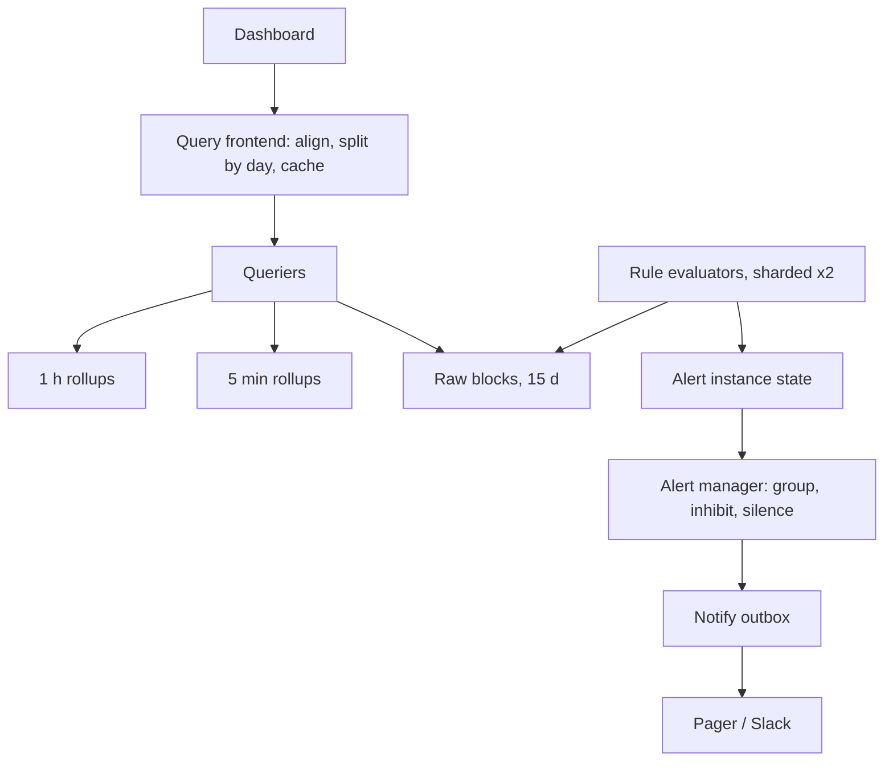
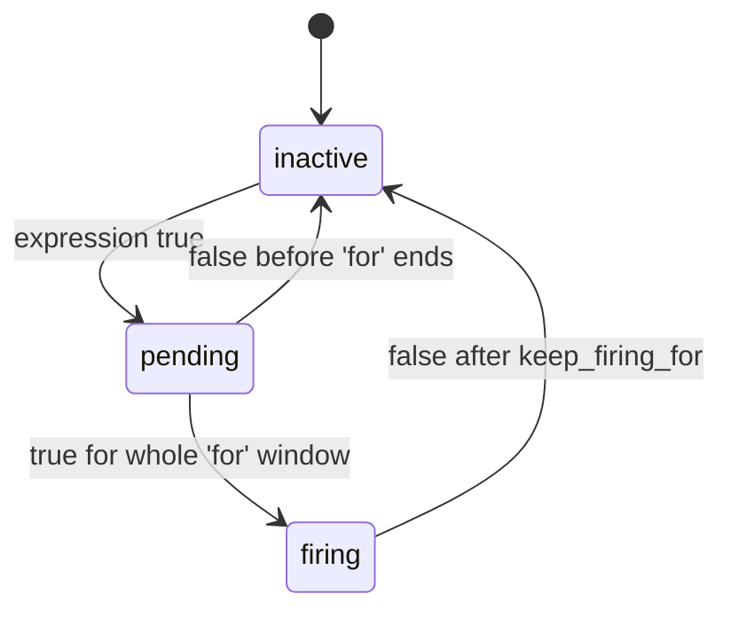

<!-- day-nav -->
[← Day 63 — Mock: job scheduler](63-mock-job-scheduler.md) · [Day 65 — Payments →](65-payments.md)

# Day 64 — Metrics query and alerts

**Do now**

1. Set a timer.
2. Attempt the problem. Stop at the attempt line. Do not scroll.
3. Then read.

## Time box

40 minutes.

| Minutes | Do this |
|---|---|
| 0–12 | Attempt. Graphs and alerts on stored series. Stop one rule from paging on every blip. |
| 12–32 | Read. Ingest was day 62. Today is read path, downsample, and alert fatigue. |
| 32–40 | Say how a dashboard query is served, and how alerts debounce/flap. |

## Intent

Facing graphs and pages rather than ingest, leave able to query downsampled series and stop one alert rule from paging on every blip.

## Problem

> Design metrics query and alerts.
>
> People open dashboards of time-series graphs. Alert rules page a human when a condition holds. A noisy rule must not page on every blip.

## Attempt before reading

12 minutes. Do not scroll.

Write:

1. Query API: range, step, aggregations.
2. Where raw vs downsampled data lives; which the UI hits for 7-day vs 6-hour views.
3. Alert evaluation cycle: pending → firing → resolved.
4. Flapping: hysteresis, for-duration, silence, grouping.
5. One bad rule × 10,000 series — cardinality of alerts.

---

**Stop. Downsampled read path. Alert state machine with for-duration. Group pages.**

---

## Requirements

**In.** Range queries with aggregations: sum, average, and p99 across labels (labels are the tags on a series, like `service="checkout"` or `pod="web-17"`). Typical dashboard panels answer in **1–5 s**. Alert rules written as expressions with a `for` duration, sending to Slack or a pager. Silences (mute a known alert for a set window). Retention from day 62: raw samples for 15 days, 5-minute and 1-hour rollups for longer.

**Assumptions.** Raw samples every **15 s** (a common scrape interval). **5,000** panel queries/s at peak. **20,000** alert rules, evaluated every **30 s**. About **40** services, the biggest running **2,000** pods. One region.

**Out.** Rebuilding the ingest path, log search, and machine-learning anomaly detection.

## Estimates

- **One series, 30 days, raw.** 30 × 86,400 / 15 = **172,800** points. One line is fine.
- **One panel, 30 days, raw.** `sum by (service)` over 2,000 pods: 2,000 × 172,800 ≈ **346 M** samples. At roughly 1.4 bytes per compressed sample (Gorilla-style encoding), that's about **480 MB** to fetch and decompress for one panel. Fifty panels times a few hundred viewers is how the query tier melts.
- **Same panel, 1-hour rollup.** 2,000 × 720 = **1.44 M** samples, about **240×** less work. A 1,000-pixel-wide chart can't draw more than about a thousand points anyway.
- **Alert eval.** 20,000 rules / 30 s ≈ **670** rule evaluations/s. If an average rule touches 50 series, that's about **33,000** series reads/s, small next to dashboards. The danger is one rule that touches a million series, not the average.
- **Notifications.** One bad deploy can make 2,000 per-pod alerts fire at once. Grouped by `{alertname, service}`, that's **1** page.

The number that flips the design: the ratio of time range to step. Get that wrong and one panel costs 240× what it should.

## API and data

```
GET /v1/query_range?query=<expr>&start=<t0>&end=<t1>&step=<seconds>
  → 200 {series: [{labels, points: [[t, v], ...]}]}
  → 400 too many points (range / step over the cap)
  → 422 series limit hit (query matched too many series)
```

**Point cap.** Reject any query that asks for more than about **11,000** points per series (Prometheus uses that limit). 30 days at a 15 s step is 172,800 points, so the API forces a bigger step.

**Rule.** `rule_id, group, expr, for, keep_firing_for, labels, annotations, owner`. Rules live in groups. A group runs in order on one evaluator, so a recording rule can feed an alert rule in the same group.

**Alert instance.** `(rule_id, label_set_hash) → {state: inactive | pending | firing, active_since, last_eval}`. The label-set hash is just a stable ID for "this rule, on this exact set of labels", so `HighCPU{pod="web-17"}` and `HighCPU{pod="web-18"}` are two instances of one rule.

**Notify outbox.** Rows the alert manager has to deliver, with retries. A Slack outage mustn't drop a page.

## Design

### Query path

1. **Query frontend** gets the request and snaps `start` and `end` to multiples of `step`. Two people opening the same dashboard a few seconds apart then send identical queries, and the second one hits the cache.
2. **Split by day.** A 30-day query becomes 30 one-day queries. Finished days are cached for a long time because old data doesn't change. Only today's slice runs fresh.
3. **Pick the resolution from the step.** Step under 5 minutes: raw blocks. Step of 5 minutes to 1 hour: 5-minute rollups. Bigger: 1-hour rollups. A background compactor builds rollups as blocks age. Thanos, for example, makes 5-minute rollups after about 40 hours and 1-hour rollups after about 10 days.
4. **Queriers** fan out to storage, merge, and aggregate. Each query has a series limit and a sample limit, so one bad panel fails alone.

**Rollups must keep more than the average.** Store min, max, sum, and count for each bucket. Average alone hides the spike that caused the incident, and you can't rebuild a sum from averages of uneven buckets.

### Alert evaluation

Every 30 s, each evaluator runs its rule groups:

- **inactive → pending** the first time the expression is true for an instance.
- **pending → firing** once it has stayed true for the whole `for` window. Any false evaluation in between sends it back to inactive, and the clock restarts.
- **firing → resolved** when it's false again. `keep_firing_for` (Prometheus 2.42+) holds it firing for a while after it clears, so a value hovering at the threshold doesn't fire, resolve, and fire again.

**True hysteresis** (fire above 90%, resolve only below 70%) takes two thresholds. You can write it as an expression that checks whether the alert is already firing. Or use `keep_firing_for`, which is simpler and usually enough.

**Sharding.** Hash rule groups across evaluator replicas. Run two copies of each shard so one crash doesn't silence alerts. Both copies send to the alert manager, which removes duplicates by label set.

### Alert manager: turning alerts into pages

- **Group** by `{alertname, service}`. Wait `group_wait` (default 30 s) after the first alert so its siblings join the same page.
- **Group interval** (default 5 min): new alerts joining a group that's already open go out in the next batch, not as a page each.
- **Repeat interval** (default 4 h): re-page a still-firing group only this often.
- **Inhibit:** if `ClusterDown` is firing, mute `PodDown` for that cluster. The root cause pages; its symptoms don't.
- **Silence:** a time-boxed mute with an owner and a reason, for planned maintenance.

### Bad-rule protection

- Cap series per rule (say **10,000**) and alert instances per evaluation.
- Over the cap: **disable the rule**, raise a meta-alert to its owner, and keep evaluating every other rule.
- A **recording rule** precomputes an expensive expression into a new series every cycle. The alert then reads one cheap series instead of re-aggregating 2,000 pods each time.

### Watching the watcher

If the alert pipeline itself dies, nothing pages. Run a **dead-man's switch**: an alert that always fires, sent to an outside service that pages if it *stops* hearing it. Also page on evaluation lag (wall clock minus last finished evaluation) and on outbox delivery errors.

### Worked numbers

The rule is `cpu > 90%`, `for: 5m`, evaluated every 30 s, with `group_wait: 30s`.

- **A 40-second blip** at 12:00:10 is true for at most two evaluations. The next false one resets it to inactive. **No page.** Without `for`, someone gets woken at 3 a.m. for nothing.
- **A real overload** starting at 12:00:00 is first seen at the 12:00:30 evaluation and goes pending. It fires at the first evaluation at least 5 minutes later, 12:05:30. After `group_wait` the page goes out around **12:06**. Say that number in the interview: `for` + one evaluation interval + `group_wait` is your worst-case time to page.
- **A bad deploy** hits 2,000 pods of `checkout`. That's 2,000 firing instances, **1** page for `{HighCPU, checkout}`, re-sent every 4 hours while it lasts.

## Diagrams



Caption: "Dashboards and evaluators read the same storage through separate pools. A viral dashboard can't delay a page."



## Failure the user sees

**Dashboard stampede.** An incident starts and 300 engineers open the same 50-panel dashboard. Step alignment and day-split caching collapse most of it into cache hits. What's left hits a query pool that alerts don't share. Users see slow graphs, and pages still go out on time.

**Alert flap.** No `for`, no `keep_firing_for`. The rule pages, resolves, and pages again every few minutes. On-call starts ignoring it. That's a product failure of the rule, not of the human.

**Rule cardinality bomb.** A rule with no `by` clause on a per-request-path metric matches 1 M series. The cap trips, the rule is disabled, and its owner gets a meta-alert. The other 19,999 rules keep running.

**Ingest healthy, eval lagging.** Evaluators fall 4 minutes behind. Every page is 4 minutes late and nobody notices, because the ingest graphs look fine. Alert on evaluation lag directly.

**Wrong step on a long range.** A script asks for 30 days at 15 s. The point cap returns 400, or the frontend widens the step. It never runs a 346 M-sample scan.

**Rollup hides a spike.** A 1-hour average shows 40% CPU. The 1-hour max shows 100%. Store and show max, or the postmortem graph lies.

## Trade-offs

**Shared vs split pools for query and eval.** Split. Dashboard chaos must not delay pages.

**Raw forever vs rollups.** Rollups for old data, with retention stated per resolution. You lose the ability to zoom into a 15-second spike from last month. Say so.

**Long `for` vs short `for`.** Longer means fewer false pages but a slower real page. Five minutes is a common default. For "the site is down", use 1 minute plus a stricter expression.

**Static thresholds vs SLO burn-rate alerts.** Burn-rate alerts ("at this error rate we'll use 2% of the monthly error budget in 1 hour") page on user impact and flap less. They need an SLO defined first (day 81).

**Name the refusal inside each alternative.** Against one pool for dashboards and alerts: you refuse on-call latency tied to a viral dashboard. Against no `for`: you refuse flap. Against unbounded rule fan-out: you refuse evaluator death. Against 30 days of raw data by default: you refuse scan storms. Against paging per pod: you refuse 2,000 pages for one deploy.

**10× query QPS.** More querier replicas and a bigger results cache. Rollups stay. Eval capacity is sized on rules × series, not on dashboard traffic.

## Talking points

**If they only talk ingest.** "Day 62 covered writes. Today is the read path and pages."

**If they ask how alerts avoid flap.** "A `for` window on the way in, `keep_firing_for` or two thresholds on the way out, and grouping by service."

**If they ask about time to page.** "`for` + one evaluation interval + `group_wait`. With 5 minutes, 30 s, 30 s, that's about 6 minutes worst case."

**If they ask what happens when a rule is huge.** "Hard series cap. Disable it and tell the owner. Don't try to run it anyway."

**If they ask about recording rules.** "Precompute expensive expressions into new series. You pay storage to save evaluator CPU."

**If they ask what pages the alerting team.** "Evaluation lag, outbox delivery errors, disabled-rule count, and the dead-man's switch, not just dashboard p99."

## Say this in the room

Dashboards go through a query frontend that aligns time ranges to the step, splits long ranges by day, and caches finished days. The planner reads raw, 5-minute, or 1-hour data based on the step, and it stores min, max, sum, and count so rollups don't hide spikes. Alerts are evaluated every 30 seconds into an inactive, pending, firing state machine. The `for` window stops blips from paging, and `keep_firing_for` stops flapping on resolve. The alert manager groups by service, inhibits symptoms when the root cause fires, and repeats every few hours, so one bad deploy is one page. Rules have series caps and get disabled rather than taking the evaluators down. Evaluators run in their own pool, two copies per shard, and a dead-man's switch pages if the whole pipeline goes quiet.

### Staff depth: time to page is a number you can compute

Worst case is `for` + evaluation interval + `group_wait`. Every knob trades false pages against slow real ones. Staff candidates say the number and which knob they'd turn.

**Pool split.** Alert eval and dashboard query don't share a fate.

**Rollups keep max.** Averages hide incidents.

**What staff sounds like.** Step-aligned cached queries, rollups with max, `for` plus `keep_firing_for`, grouped and inhibited pages, capped rules, a dead-man's switch.

### More probes, with the answer

**"What pages?"** Evaluation lag and outbox errors, from Failure, not only CPU. **"What do you refuse?"** Pick one refusal from Trade-offs and say the problem it prevents. **"What's the sensitive assumption?"** Range-to-step ratio. If panels default to raw, the query tier is 240× undersized.

## Kit artifact

| Follow-up | You answer with |
|---|---|
| "Too many pages." | `for` window, group by service, inhibit symptoms, rule series cap. |
| "How fast does a real problem page?" | `for` + eval interval + `group_wait`, about 6 min with 5m/30s/30s. |
| "The 30-day dashboard is slow." | Step-aligned, day-split cache; read 1-hour rollups with max kept. |

## Design log

One line: your `for` window, your worst-case time to page, and how you stop one rule from matching a million series.

Next: [Day 65 — Payments](65-payments.md). Authorize, capture, idempotent ledger.

---

<!-- day-nav -->
[← Day 63 — Mock: job scheduler](63-mock-job-scheduler.md) · [Day 65 — Payments →](65-payments.md)
