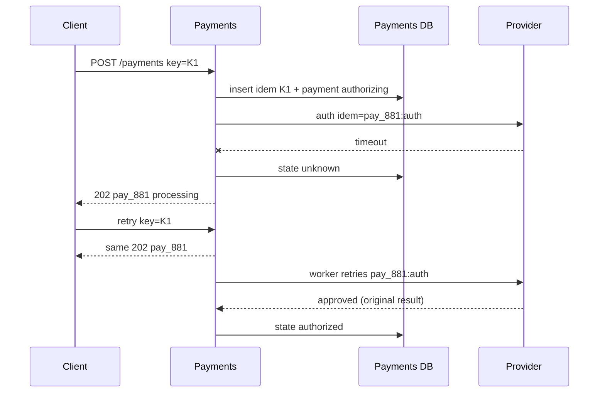
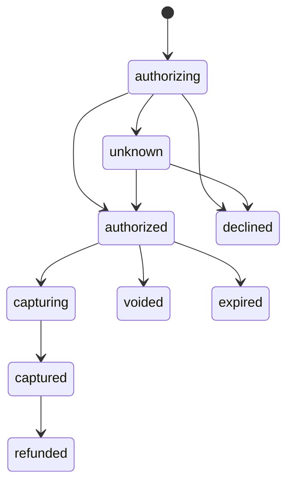

<!-- day-nav -->
[← Day 64 — Metrics query and alerts](64-metrics-query-and-alerts.md) · [Day 66 — Payment reconciliation →](66-payment-reconciliation.md)

# Day 65 — Payments

**Do now**

1. Set a timer.
2. Attempt the problem. Stop at the attempt line. Do not scroll.
3. Then read.

## Time box

40 minutes.

| Minutes | Do this |
|---|---|
| 0–12 | Attempt. Authorize and capture against an idempotent ledger. Retry must not move money twice. |
| 12–32 | Read. If the ledger append is not idempotent, you failed. Provider calls need keys too. |
| 32–40 | Say ledger entries, idempotency keys, and auth vs capture. |

## Intent

Facing money movement, leave able to authorize and capture against an idempotent ledger so a retry cannot move money twice.

## Problem

> Design payments.
>
> A buyer pays for an order. You authorize a card (or similar), then capture when the order is firm. Retries and timeouts must not charge the buyer twice.

## Attempt before reading

12 minutes. Do not scroll. Reconciliation is day 66.

Write:

1. States: created → authorized → captured / voided / failed.
2. Idempotency keys on client, on provider, on ledger.
3. What the ledger row is; append-only?
4. Timeout after authorize request: am I charged?
5. Partial capture / multi-capture — in or out?

---

**Stop. Ledger first. Provider second with idempotent keys. Auth ≠ capture.**

---

## Requirements

**In.** Authorize, capture (full or one partial), void, refund. Amounts in minor units (paise, cents) plus a currency code, never floats. Every mutating call takes an idempotency key. A double-entry ledger records every money movement per merchant and per platform account.

**Assumptions.** **1,000** payments/s at peak, about **200/s** on average. One payment service provider (PSP), Stripe-shaped. One region owns the ledger. Card data never touches our servers: the client sends a provider token.

**Out.** Multi-PSP routing, crypto, securities ledgers (Day 74), the reconciliation deep dive (Day 66, but name the need), chargebacks beyond one sentence.

## Estimates

- **Payments per day.** 200/s × 86,400 s ≈ **17M**.
- **Ledger rows.** A capture books about 4 entries (customer side, merchant payable, PSP fee, platform fee). 17M × 4 ≈ **70M rows/day**. At ~150 bytes a row that's about **10 GB/day**, so ~3.8 TB a year before indexes. Partition by month.
- **Peak writes.** 1,000/s × 4 ≈ **4,000 inserts/s** at peak. One well-tuned relational primary can take that. Shard by `merchant_id` when it can't, because a payment never moves money across two merchants.
- **Unknowns.** If 0.1% of provider calls time out, that's **1/s** at peak, about **3,600 an hour** sitting in `unknown`. That number sizes the recovery worker, and it's also the number of double charges per hour you'd cause by retrying with a fresh key.

The cliff here is correctness under retries, not network bandwidth.

## API and data

`POST /v1/payments` `{order_id, amount, currency, payment_token, capture: "manual" | "auto"}` with header `Idempotency-Key: K`

`POST /v1/payments/{id}/capture` `{amount?}` with its own key. `POST /v1/payments/{id}/void`. `POST /v1/payments/{id}/refunds` `{amount}`.

`GET /v1/payments/{id}` is what the client polls while a payment is `unknown`.

**Idempotency table.** `(merchant_id, key)` unique, `request_hash`, `payment_id`, `response`, `created_at`. Same key with a different body returns **422**, not a second payment.

**Payment row.** `id, merchant_id, order_id, amount, currency, state, captured_amount, refunded_amount, psp_ref, auth_expires_at, version`.

**Ledger entries.** Append-only: `entry_id, txn_id, account_id, amount_signed, currency, payment_id, kind`. Every `txn_id` sums to zero. A unique index on `(payment_id, kind, seq)` makes "book the capture" safe to run twice. Balances are projections of entries, never a column you overwrite.

## Design

### The state machine

`created` → `authorizing` → `authorized` | `declined` | `unknown`. From `authorized`: `capturing` → `captured`, or `voided`, or `expired`. From `captured`: refunds until `refunded_amount = captured_amount`.

Every transition is a conditional update: `UPDATE payments SET state='capturing', version=v+1 WHERE id=? AND state='authorized' AND version=v`. Zero rows updated means someone else got there first. Read the row and return what it says.

### Authorize, in order

1. **One local transaction.** Insert the idempotency row and the payment in `authorizing`. Commit. If the key already exists, return the stored response and stop.
2. **Call the PSP** with a provider idempotency key derived from our id, like `pay_123:auth`. The client's key protects our API. The derived key protects the provider call. You need both.
3. **Second local transaction.** Move to `authorized` (or `declined`), store `psp_ref` and `auth_expires_at`, save the response on the idempotency row.
4. **Timeout or 5xx.** Move to `unknown`. Return **202** with the payment id. The client shows "Payment processing" and polls `GET`.

Auth books no money entries. Money hasn't moved yet. If finance wants holds visible, book them in a memo account that never feeds a balance.

### Capture, void, refund

- **Capture.** Conditional move `authorized` → `capturing`. Call the PSP with key `pay_123:capture:1`. On success, one transaction: state `captured`, `captured_amount`, the 4 ledger entries, and an outbox row `payment.captured` so the order service ships. Partial capture is allowed with `amount ≤ authorized`. The provider releases the rest. Multi-capture depends on the provider and card network, so keep it out unless asked.
- **Void.** Only from `authorized`. It releases the hold. No ledger entries, because nothing moved.
- **Refund.** Only against captured money: `UPDATE ... SET refunded_amount = refunded_amount + :x WHERE id=? AND refunded_amount + :x <= captured_amount`. In the same transaction, write the refund entries. Two refund clicks can't both pass the guard.

### Resolving unknown

A recovery worker scans `unknown` and `capturing` rows older than 30 s. It retries with the **same** provider key, or looks the payment up by our reference. Backoff runs 30 s, 1 min, 2 min, 4 min.

The deadline is real. Stripe may prune an idempotency key once it's **24 hours** old, and after that the same key can create a new charge. So unknowns must resolve well inside a day. Anything older than a couple of hours goes to a human queue and to Day 66 reconciliation.

Provider webhooks are the second path in. Dedupe them by event id, and apply them only through the same conditional transitions. A late `authorized` webhook can't drag a `captured` payment backwards.

### Crash windows

1. **Before the PSP call.** Row says `authorizing`, provider never heard of it. The worker retries with the same key. Safe.
2. **After PSP success, before our commit.** Provider holds money we can't see. The worker's retry returns the original result, and we commit then.
3. **After our commit, before the client hears back.** The client retries with key `K`. The idempotency row returns the stored response.

### Worked numbers

A buyer pays ₹2,499 for headphones. Delayed shipping, so `capture: "manual"`.

- **10:00:00.** `POST /payments`, key `K1`. The payment row goes in as `authorizing`. The PSP call with `pay_881:auth` hangs past our 10 s timeout. State `unknown`, client gets 202 and shows "Processing".
- **10:00:12.** The buyer's app retries with `K1`. The idempotency row exists, so they get the same `pay_881`, still `unknown`. No second call to the PSP.
- **10:00:40.** The worker retries `pay_881:auth`. The PSP returns the original approval. State `authorized`, `auth_expires_at` set about 7 days out (check your provider; card networks vary).
- **Day 2.** The warehouse ships one of two items. Capture ₹1,999 with `pay_881:capture:1`. Ledger: customer side −199,900 paise, merchant payable +193,903 (after fees), PSP fee +3,998, platform fee +1,999 (example rates: 2% and 1%). The entries sum to zero. The provider releases the remaining ₹500.
- **What a new key would have cost.** At 10:00:12, a fresh key means a second ₹2,499 hold. The buyer sees ₹4,998 pending on their banking app and calls support.

## Diagrams

Caption: "Same key, same payment. The timeout becomes a state the worker resolves, not a second charge."

Caption: "Every arrow is a conditional update. No arrow goes backwards."

## Failure the user sees

**Timeout on authorize.** "Payment processing", then success a minute later. Never "Payment failed" while the provider might have approved. That lie makes the buyer pay again with another card.

**Capture after the auth expired.** Provider declines. The order must not ship. State `expired`, and the merchant asks the buyer to pay again.

**Our commit fails after provider success.** The buyer's bank shows a hold, our app shows "processing". The worker closes it within minutes. If it can't, Day 66 reconciliation finds it, and support has a ticket rather than silence.

**Provider outage.** New checkouts get a clear "try again shortly". Rows in flight stay `unknown` and retry with the same keys. Don't call it a decline.

**Double refund click.** The guarded update lets one through. The second gets the current payment back, not a second refund.

## Trade-offs

**Auth plus capture together vs separate.** Together for digital goods delivered at once. Separate when you ship later, so you don't take money for stock you might not have.

**Our row first vs provider first.** Write our row first, call the provider, then commit the result. Every crash leaves a row the worker can find. Provider first leaves money we may never learn about.

**Synchronous answer vs 202 plus polling.** Synchronous is simpler until timeouts. 202 lets `unknown` be honest in the UI.

**Name the refusal inside each alternative.** Against a new idempotency key on retry: you refuse a double hold. Against treating unknown as declined: you refuse telling a buyer they failed when they paid. Against a mutable balance column: you refuse books you can't audit. Against refunds without the guarded update: you refuse giving back more than you took.

**10× checkout.** More workers, same rules. Shard the ledger by merchant. Provider rate limits become the ceiling, so shed new checkouts before you starve the recovery worker.

## Talking points

**If they retry with a new key.** "That's how you double-charge. Same key until the payment reaches a final state."

**If they ask auth vs capture.** "Auth holds the money. Capture takes it. Delayed shipping means a separate capture before the hold expires."

**If they ask what unknown means in the UI.** "Processing, not failed. The app polls, the worker resolves, and reconciliation catches the rest."

**If they ask about PCI.** "Hosted fields and provider tokens. Our servers never see the card number."

**If they ask how idempotency keys expire.** "Ours live at least as long as the provider's. Stripe can prune keys after 24 hours, so unknowns must resolve well inside that."

## Say this in the room

Payments are a state machine with a double-entry ledger. I write our row first with the client's idempotency key, call the provider with a key derived from our payment id, then commit the result. A timeout is `unknown`, not a decline and not a cue to mint a new key. A worker retries the same key well inside the provider's 24-hour window. Capture books balanced ledger entries in the same transaction as the state change, and refunds pass a guard so they can't exceed what we captured.

### Staff depth: unknown is a state, and it has a deadline

Most candidates say "use idempotency keys". Staff candidates say which keys (client to us, us to provider, ledger unique index), what happens on timeout (202, `unknown`, worker), and when the safety runs out (provider key pruning, about 24 hours on Stripe).

**What staff sounds like.** Three crash windows named. Conditional transitions with a version check. Entries that sum to zero. 3,600 unknowns an hour at 0.1% timeouts, and why each one would be a double charge with a fresh key.

### More probes, with the answer

**"What pages?"** Count of `unknown` older than 15 minutes, and capture failures before auth expiry. Not CPU. **"What do you refuse?"** Treating unknown as declined, because it makes buyers pay twice. **"What's the sensitive assumption?"** The timeout rate. At 1% instead of 0.1%, the worker handles 36,000 unknowns an hour and the provider's rate limit becomes the problem.

## Kit artifact

| Follow-up | You answer with |
|---|---|
| "Timeout on authorize." | State `unknown`, 202 to the client, worker retries the same provider key. Never a new key. |
| "Same key, different amount." | 422. The idempotency row stores a request hash. |
| "Two refund clicks." | Guarded update: `refunded + x ≤ captured`, entries in the same transaction. |
| "How long is the key safe?" | Until the provider prunes it (Stripe: 24 h). Resolve unknowns in minutes; escalate after hours. |
| "Where's the balance?" | Sum of append-only entries per account. Each transaction sums to zero. |

## Design log

One line: your idempotency story across client, ledger, and provider.

Next: [Day 66 — Payment reconciliation](66-payment-reconciliation.md). Fix mismatch without rewriting history.

---

<!-- day-nav -->
[← Day 64 — Metrics query and alerts](64-metrics-query-and-alerts.md) · [Day 66 — Payment reconciliation →](66-payment-reconciliation.md)
