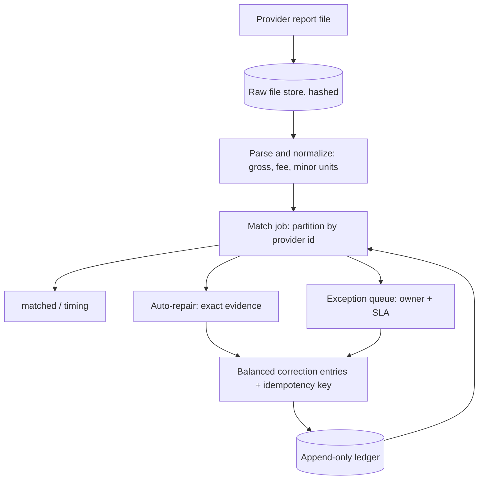

<!-- day-nav -->
[← Day 65 — Payments](65-payments.md) · [Day 67 — Collaborative document →](67-collaborative-document.md)

# Day 66 — Payment reconciliation

**Do now**

1. Set a timer.
2. Attempt the problem. Stop at the attempt line. Do not scroll.
3. Then read.

## Time box

35 minutes.

| Minutes | Do this |
|---|---|
| 0–10 | Attempt. Provider and ledger disagree. Find and repair without silent history rewrite. |
| 10–28 | Read. If you UPDATE ledger amounts in place, undo that. |
| 28–35 | Say the mismatch types, the job that finds them, and the repair entry shape. |

## Intent

Facing a provider and a ledger that disagree, leave able to find the mismatch and repair it without a silent rewrite of history.

## Problem

> Design payment reconciliation.
>
> Your ledger and the payment provider's reports sometimes disagree. You must find mismatches and repair them without silently rewriting history.

## Attempt before reading

10 minutes. Do not scroll.

Write:

1. Sources: ledger entries vs PSP settlement files / API.
2. Match keys (payment id, provider charge id, amount, time window).
3. Mismatch classes: missing local, missing remote, amount differ, duplicate.
4. Repair: compensating ledger entries vs edit-in-place.
5. Who approves automatic vs manual repair.

---

**Stop. Append-only repairs. Recon job with evidence. No silent UPDATE of history.**

---

## Requirements

**In.** A daily recon run per payment provider (the company that actually moves card money, like Stripe or Adyen). An exception queue with an owner and an SLA. Auto-repair for classes with unambiguous evidence. Every repair is a new, balanced ledger entry. Reruns are safe.

**Assumptions.** **1k** payments/s on average, so **~86M** payments a day. One provider to start. Reports land once a day, **T+1** to **T+2** after the charge. Day 65's ledger is append-only and double-entry (every entry debits one account and credits another by the same amount).

**Out.** The online authorize/capture path (day 65), multi-currency FX, bank-rail (ACH/SEPA) quirks, the full chargeback dispute flow.

## Estimates

| Quantity | Value | Why it matters |
|---|---|---|
| Payments/day | 1k/s × 86,400 s ≈ **86M** | Batch size per run |
| Report rows/day | 1–3 per payment (charge, fee, refund) ≈ **100–250M** | The join is big but boring |
| Raw report size | ~200 B/row ≈ **20–50 GB/day** | Store raw files; reprocess later |
| Partitions | hash(`provider_charge_id`) into 64 → **~2–4M** rows each | Each fits one worker's memory |
| Exceptions at 0.01% | **~8.6k/day** | Humans cannot clear that; auto-repair is not optional |
| Exceptions at 1% | **~860k/day** | Not a recon problem. Page: something upstream broke |

The staff move is the last two rows. A "small" exception rate at this volume is still thousands of tickets a day. Decide which classes the machine repairs before you decide the queue UI.

## API and data

```text
report_file(file_id, provider, report_date, sha256, received_at, status)
report_line(file_id, line_no, provider_charge_id, type, gross, fee, net, currency, event_time)
recon_run(run_id, provider, report_date, file_sha256, started_at, finished_at, counts)
recon_result(run_id, provider_charge_id, class, ledger_entry_ids, report_line_ref, age_days)
exception(exc_id, class, payment_id, evidence_refs, state, owner, opened_at, sla_due)
ledger_entry(entry_id, txn_id, account, debit, credit, currency, reason, corrects_entry_id?, idempotency_key)
```

- `report_file` is immutable. The hash is the identity. A provider that re-issues a file produces a new row, not an overwrite.
- `idempotency_key` on a correction is `(provider, provider_charge_id, class, report_file_sha256)`. A rerun of the same file posts nothing new.
- A correction points at the entry it fixes with `corrects_entry_id`. The original stays.

## Design

### Ingest: keep the raw file

Pull the report (SFTP or API) into object storage as-is. Hash it. Parse into `report_line`. Never trust a parsed table you cannot rebuild from the raw file. Providers do re-issue reports, and the auditor will ask what the file said on the day.

### Normalize before you join

- **Gross vs net.** The provider pays you net (gross minus fees). Match on gross. Post the fee as its own entry. Most "amount mismatches" in a naive design are fees.
- **Units.** Minor units (cents, paise) as integers. No floats anywhere.
- **Day boundary.** The provider's report day is often UTC. Your ledger may close on local time. A charge at 02:00 IST on the 4th is 20:30 UTC on the 3rd. Match on a window (report day ± 1), not an exact date.

### Match: one key, then classify

Partition both sides by `hash(provider_charge_id)`, then sort-merge or hash join per partition. Every pair gets exactly one class:

| Class | Meaning | Default action |
|---|---|---|
| `matched` | Same id, same gross, same currency | None |
| `timing` | Ledger capture, no report line yet, age < lag SLO | Wait. Not an exception |
| `missing_local` | Provider charged, we have no capture | Auto-repair if the provider id and amount are exact |
| `missing_remote` | We captured, provider has nothing past lag SLO | Human queue. Usually a timeout that declined |
| `amount_mismatch` | Same id, gross differs | Delta correction; human if above a threshold |
| `duplicate` | Two ledger captures for one provider id | Human queue. Check day 65 idempotency first |
| `unknown_money` | Report line with no id we recognise | Post to a suspense account, human queue |

The **suspense account** is a real accounting tool: money you know arrived but cannot yet attribute. It keeps the books balanced while a human investigates. Clearing it later is another pair of entries.

### Repair: append, balanced, idempotent

Every repair is a transaction with equal debits and credits:

- `missing_local`: debit `provider_receivable`, credit `customer_payment`. Link the report line. Emit an event so the order moves from `pending` to `paid`.
- `amount_mismatch` of +₹50: post only the ₹50 delta, `corrects_entry_id` set to the original. Never UPDATE the old row.
- `missing_remote` confirmed declined: reverse the capture with an opposite entry. Stop fulfilment if it has not shipped.

The idempotency key means a crashed run can restart from the top. The second pass finds the corrections already posted and skips them.

### Automation policy

Auto-repair needs **all three**: an exact provider id, an exact amount and currency, and a local state that is unknown or pending (never a state a human already touched). Everything else goes to a person. Write-offs above a threshold need a second approver. Track the auto-repair reversal rate: if humans keep undoing the machine, tighten the rule.

### Aging, not just matching

Unmatched rows carry `age_days`. Report by bucket: 0–2 days is normal lag, 3–7 days is a ticket, over 30 days goes to finance. The dashboard leaders care about is **unmatched money by age**, not row counts.

### Worked numbers

Say the ledger closes its day at midnight IST and the provider's report day is UTC. IST runs 5.5 hours ahead, so a payment made between 00:00 and 05:30 IST lands on the **previous** UTC day. Payments made after 05:30 IST get the same date on both sides. Only that early-morning slice disagrees, and those are quiet hours for most consumer traffic, so the share is far below 5.5 ÷ 24. (That fraction would be right only if traffic were flat all day. It is not.)

The real share depends on your traffic shape, so treat any number as an assumption. Say **3%** of daily volume falls between 00:00 and 05:30 IST. At the ~86M payments a day from the assumptions, that is about **2.6M** rows a day with a different date on each side. If your traffic is flatter, say 8%, it is closer to 7M. Either way, exact-date matching turns every one of them into a false exception. The ±1 day window removes them for free; the cost is a slightly bigger join.

## Diagrams



Caption: "Keep the file. Match on one key. Append the fix."

## Failure the user sees

**Charged, order stuck.** Provider captured, your row never landed (day 65 timeout). Recon classifies `missing_local`, auto-repairs, and the order moves to `paid` the next morning. The customer saw "pending" for a day. Cut that by having the day 65 status checker poll unknowns within minutes; recon is the safety net, not the first line.

**Shipped, never paid.** `missing_remote` past lag SLO. The capture timed out and actually declined. Reverse the capture. If the goods shipped, it becomes a collections case for a human.

**Report late or re-issued.** No file, no run. Do not treat every pending capture as missing. Page on file lateness itself. On a re-issue, the new hash means a new run; idempotency keys stop double-posting.

**Wrong match.** Two ₹499 payments in the same minute. Matching on amount and time swaps them. Match on `provider_charge_id` only.

**Eager machine.** Auto-repair "fixes" a row a human was investigating. The policy above refuses any row a human already touched.

## Trade-offs

**Auto-repair vs human queue.** Auto for exact key plus exact amount. Humans for anything fuzzy. At 8.6k exceptions a day, the split decides whether finance drowns.

**Append vs rewrite.** Always append. A mutable amount column cannot answer "what did we believe on 3 March?"

**Daily batch vs streaming recon.** Batch, because the provider truth arrives as a daily file. Streaming buys nothing until the provider offers event-level settlement data.

**Name the refusal inside each alternative.** Against silent UPDATE: you refuse unauditable books. Against amount-and-time matching: you refuse mis-attribution. Against exact-date matching: you refuse millions of false exceptions a day (about 2.6M at a 3% early-morning share). Against fuzzy auto-repair: you refuse the machine moving money on a guess. Against non-idempotent reruns: you refuse double corrections after a crash.

**10× volume.** ~860M payments a day. Same job, 640 partitions instead of 64. The rules do not change. Exceptions at the same rate become ~86k a day, so auto-repair coverage matters more, not less.

## Talking points

**If they UPDATE the ledger in place.** "Append a correction that points at the original. History is evidence."

**If they match on amount alone.** "Collisions. Match on the provider's charge id."

**If they ask about fees.** "Match gross. Post the fee as its own entry. Net mismatches are usually fees."

**If they ask what happens on a rerun.** "Corrections carry an idempotency key from provider, charge id, class, and file hash. A rerun posts nothing new."

**If they ask about money nobody can explain.** "Suspense account. The books stay balanced while a human finds the owner."

**If they ask who gets paged.** "File late, exception rate spikes, or unmatched money past the lag SLO. Not every T+1 pending."

## Say this in the room

Reconciliation is a daily batch match between the provider's report and our append-only ledger, keyed on the provider's charge id. I keep the raw file hashed, match gross and post fees separately, and use a ±1 day window because report days and ledger days rarely share a timezone. Normal lag is a state, not a break. Exact evidence auto-repairs with balanced, idempotent correction entries; everything fuzzy goes to a person with an SLA. Unknown money sits in a suspense account. I refuse silent UPDATEs of past rows. Day 65 made "unknown" a state; today closes it.

### Staff depth: correction entries are the repair

Balances are projections over the log. Auditors read the log, not a balance column. Every correction cites the recon run and report line, which is what day 76's audit log stores.

**Lag window.** Inside the settlement lag, pending is fine. Outside it, it's a ticket. Report unmatched money by age bucket.

**What staff sounds like.** Raw file kept, one match key, gross vs net, timezone window, idempotent append-only repairs, suspense account, refuse fuzzy auto-repair.

### More probes, with the answer

**"What pages?"** File lateness and exception rate per run, not CPU. **"What do you refuse?"** Rewriting history; say the question it would make unanswerable. **"What is the sensitive assumption?"** Exception rate. At 0.01% humans keep up with auto-repair help; at 1% recon is telling you day 65 is broken.

## Kit artifact

| Follow-up | You answer with |
|---|---|
| "Amounts differ." | Check fee first; else delta correction with `corrects_entry_id`, no UPDATE. |
| "We reran the job." | Idempotency key on provider, charge id, class, file hash. Nothing posts twice. |
| "Money arrived, no idea whose." | Suspense account plus human queue; clear with a second entry pair. |
| "Report and ledger days don't line up." | Report day is UTC; match on ±1 day. |

## Design log

One line: a mismatch class and whether your repair was append-only.

Next: [Day 67 — Collaborative document](67-collaborative-document.md). Concurrent edits and divergence.

---

<!-- day-nav -->
[← Day 65 — Payments](65-payments.md) · [Day 67 — Collaborative document →](67-collaborative-document.md)
