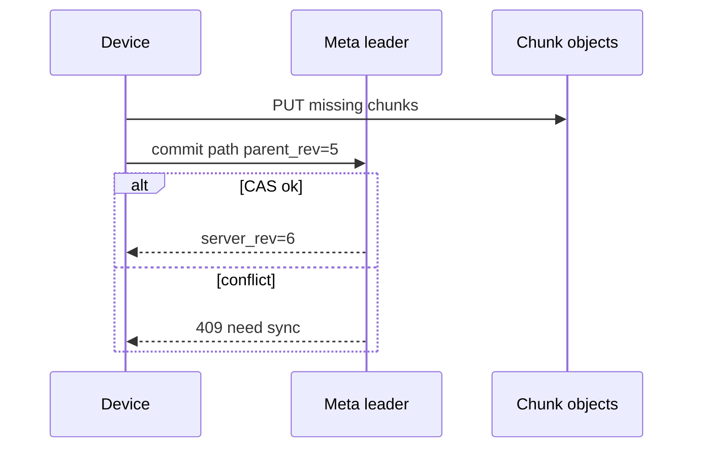

<!-- day-nav -->
[← Day 67 — Collaborative document](67-collaborative-document.md) · [Day 69 — Cart and checkout →](69-cart-and-checkout.md)

# Day 68 — File sync

**Do now**

1. Set a timer.
2. Attempt the problem. Stop at the attempt line. Do not scroll.
3. Then read.

## Time box

40 minutes.

| Minutes | Do this |
|---|---|
| 0–12 | Attempt. Folders match across devices. Chunks, conflicts, lying client clocks. |
| 12–32 | Read. If sync trusts client mtime alone, clocks will corrupt causality. |
| 32–40 | Say chunking, manifest, conflict policy, and server time authority. |

## Intent

Facing folders that must match across devices, leave able to sync chunks, resolve conflicts, and survive a client clock that lies.

## Problem

> Design file sync.
>
> A person's files appear on multiple devices. Changes upload and download efficiently. Conflicts are handled when two devices edit apart. Client clocks may be wrong.

## Attempt before reading

12 minutes. Do not scroll.

Write:

1. Content addressing / chunking strategy.
2. Namespace: path → content id + version.
3. Conflict: same path edited on two devices.
4. Why not trust client mtime for "who wins."
5. Large file resume and dedupe across users (optional).

---

**Stop. Chunked content store. Server-ordered versions. Explicit conflicts. Clocks are not truth.**

---

## Requirements

**In.** Per-user namespace (and optional shared folders thin). Files to **~50 GB**. Chunk ~4 MB. Sync incremental. Conflict copies or block-until-resolve — pick **conflict renamed copy** for consumer sync. Delete with tombstones and retention.

**Assumptions.** **50 million** users; **1%** active syncing; peak metadata ops **50k**/s. Object storage for chunks.

**Out.** Full Google Drive collab editing (day 67), photo dedupe ML, LAN-only sync.

## Estimates

- **Devices online.** 1% of 50M users syncing = **500k devices** holding an open "tell me when something changes" connection. That's a connection-count problem, not a CPU one.
- **Metadata rows.** Assume 5,000 files per user: 50M × 5,000 = **250 billion file rows**. At ~200 bytes each, about **50 TB** before indexes. That's sharded-database territory, so pick the shard key now: `namespace_id`.
- **Bytes.** Assume 20 GB stored per user: about **1 EB** logical. Object storage absorbs it. The bytes are easy; the metadata and the ordering are the design.
- **One big file.** 4 GB ÷ 4 MB = **1,024 chunks**. The chunk list is 1,024 × 32-byte SHA-256 hashes = **32 KB** of metadata per version.

## API and data

Device calls:

- `wait_for_changes(cursor)`: long poll. Returns "something changed" or times out. Cheap to hold 500k of these.
- `list_changes(cursor)` → entries + new cursor. The **cursor** is a position in the namespace's change journal.
- `has_chunks([hashes])` → which ones the server is missing.
- `put_chunk(hash, bytes)`: server recomputes the hash and rejects a mismatch.
- `commit(file_id, path, parent_rev, [hashes])` → new `server_rev`, or `409 conflict`.
- `get_chunk(hash)`: through a CDN or a signed object-storage URL.

**Tables (sharded by `namespace_id`):**

| Table | Key | Holds |
|---|---|---|
| `file` | `(namespace_id, file_id)` | current path, `server_rev`, chunk hash list, size, display mtime, deleted flag |
| `journal` | `(namespace_id, seq)` | one row per committed change; `seq` is gapless and monotonic per namespace |
| `chunk` | `(namespace_id, hash)` | object key, ref count, `last_referenced_at` |

**Tombstone** for deletes: the `file` row stays with `deleted = true` and the server's time, for **N days**.

## Design

### Chunking: fixed vs content-defined

Run the example both ways. A user inserts 1 MB at the **start** of a 4 GB video project file.

- **Fixed 4 MB chunks.** Every byte after the insert shifts by 1 MB, so every chunk boundary moves and every hash changes. Upload: **~4 GB**. An in-place overwrite would cost one chunk; an insert costs the whole file.
- **Content-defined chunking (CDC).** A rolling hash slides over the bytes and cuts a chunk wherever the hash of the last ~48 bytes matches a bit pattern. Boundaries follow the *content*, so after the insert they resync within a chunk or two. Upload: **~1–2 chunks, about 4–8 MB**. Set the mask so average chunk size is ~4 MB, with a min and max to stop tiny or huge chunks.

CDC costs CPU on the client (hashing every byte twice: the rolling hash and SHA-256). Most clients can afford it. Say both numbers and pick CDC for large files.

### Upload: chunks first, commit last

1. Client splits the file and hashes each chunk.
2. `has_chunks` with all 1,024 hashes. The server answers with the missing ones.
3. `put_chunk` for each missing chunk. Each one is durable on its own.
4. `commit` with the full hash list and `parent_rev`. The server checks every chunk exists, then does a compare-and-swap: only accept if `parent_rev` equals the current `server_rev`.

Resume falls out for free. If the network dies at chunk 900, the next `has_chunks` call says 124 are missing. Nobody restarts 4 GB.

**Garbage.** An upload that never commits leaves orphan chunks. A sweeper deletes chunks with ref count 0 **and** `last_referenced_at` older than, say, 7 days. Skip the grace period and you delete chunks for an upload that's still running.

### Ordering: the namespace journal

Every commit appends a row to `journal` with the next `seq`, in the same transaction as the `file` update. Devices sync by reading the journal from their cursor. That gives three properties:

- **One order.** All devices replay changes in the same order, so they converge on the same folder.
- **Cheap catch-up.** A laptop offline for a week asks for `seq > 48,211` and gets just the delta.
- **Server time is the only clock.** `server_rev` and `seq` come from the namespace's shard leader. The client's mtime gets stored for display and never decides a winner.

One leader per namespace means one write path per user, which is fine at consumer scale. A huge shared team folder is the hot spot; say you'd split it into its own namespace.

### Conflicts: compare-and-swap, then a named copy

Phone and laptop both edit `notes.txt` offline from `server_rev = 5`.

1. Laptop commits first with `parent_rev = 5`. Accepted, now rev 6.
2. Phone commits with `parent_rev = 5`. **409.** It's stale.
3. Phone pulls rev 6. It has three versions: base (5), its own, and the server's (6).
4. If the file type has a safe merge, merge. Otherwise rename local to `notes (Phone's conflicted copy 2026-10-26).txt` and commit that as a **new file**. Both edits survive.

Nobody's work gets silently overwritten, and the decision didn't touch either clock.

### Client state: the base table

The client keeps a local database: for each file, the `server_rev` and hash it last synced. Every decision is a three-way compare:

| Local vs base | Server vs base | Action |
|---|---|---|
| same | same | nothing |
| changed | same | upload |
| same | changed | download |
| changed | changed | conflict path |

**Detecting local changes.** Filesystem watchers (inotify on Linux, FSEvents on macOS) drop events under load and miss changes made while the app was off. So watch for speed and run a periodic full scan for truth.

### Renames and deletes

- **Rename is a metadata change.** `file_id` stays; only `path` changes. Treat it as delete + create and you re-upload bytes and lose version history.
- **Delete vs offline edit.** Laptop deletes at rev 5. Phone, offline, edits from rev 5. Default: **the edit wins and the file comes back** (flagged to the user). A deletion loses less than a lost edit.
- **Tombstone retention.** Keep tombstones longer than your longest supported offline window. A device offline past that gets a full resync, not a guessy diff.

### Dedupe: per namespace by default

Global cross-user dedupe saves storage, and it leaks:

- **Existence leak.** If the upload of a file is skipped, you just learned someone already stored that exact file.
- **Hash-as-key theft.** If the server ever accepts "I have hash X" without the bytes, anyone with a hash can pull the file.

So dedupe within a namespace, always make the client upload bytes the namespace doesn't have, and recompute the hash server-side. Client-side encryption breaks server dedupe entirely; say that trade if they raise privacy.

### Worked numbers

- **Notification fan-out.** 50k metadata ops/s; say each change touches 2 other devices on average → **100k wake-ups/s** to long-poll holders. Each wake-up is a tiny message; the device then calls `list_changes`. Size the poll tier by connections (500k) and the metadata tier by ops.
- **Journal growth.** 50k commits/s × ~150 bytes ≈ **7.5 MB/s, ~650 GB/day**. Compact journal entries older than the tombstone window into a snapshot per namespace.
- **Big-file edit.** CDC on the 4 GB file: 1–2 new chunks plus a 32 KB hash list. Fixed chunks with an insert: 1,024 chunks. That 500× gap is the whole reason chunking strategy is a design decision.

## Diagrams

Caption: "Chunks first. Metadata CAS on parent_rev. Server assigns rev."

## Failure the user sees

**mtime wins.** Laptop clock skew overwrites cloud with older bytes — classic bug. Server version / causal token wins; mtime is display only.

**Conflict silent clobber.** Second device loses edits. Prefer `file (conflict).ext` copy or explicit merge; say it.

**Upload dies at 99%.** Without resume, user retries 4 GB. Chunk status must allow continue.

**Dedup across tenants.** Accidental cross-user visibility or legal issue — refuse global dedup unless explicitly in scope with hash auth.

**Delete vs offline create.** Offline device recreates deleted file — define tombstone vs resurrect policy.

## Trade-offs

**Fixed-size vs content-defined chunks.** CDC better for shifts; more CPU. Fixed simpler.

**Conflict copy vs block sync.** Copy is understandable; block needs UX.

**Name the refusal inside each alternative.** Against mtime as truth: you refuse clock skew clobbers. Against whole-file reupload always: you refuse burning user bandwidth. Against silent overwrite on conflict: you refuse lost edits. Against global cross-user chunk store without design: you refuse a privacy incident. Against client-assigned versions: you refuse forks.

**10× sync QPS.** More metadata shards by user; chunk store is object storage. Conflict rules unchanged.

## Talking points

**If they trust mtime.** "Clocks lie. Server version is causality."

**If they reupload whole files.** "Chunk and resume. 4 GB with a 1 MB edit should not redo 4 GB."

**If they ask conflict UX.** "Conflict copy by default for consumer sync; enterprise may prefer block-until-resolve."

**If they ask about encryption.** "Client-side encryption means server dedup breaks; say the trade."

**If they ask what pages.** "Conflict rate, failed uploads stuck, version fork detectors."

## Say this in the room

File sync uploads content-defined chunks to object storage and tracks a server-monotonic version per file — client mtime is never the conflict winner because laptop clocks lie. A 4 GB file with a 1 MB edit should transfer about a megabyte of new chunks and resume if the network dies. Two offline writers get an explicit conflict copy or merge UX, not a silent clobber. Deletes are tombstones with a resurrect policy for offline races. I refuse global cross-tenant dedup unless privacy is in scope.

### Staff depth: one order, server time, no lost edits

- **Causality.** Server `seq` per namespace orders everything. mtime is a display field.
- **Atomicity.** Chunks are durable before the commit; the commit is one CAS plus one journal append.
- **Loss budget.** Zero silently lost edits. Conflict copies and edit-beats-delete exist to keep that number at zero.
- **What staff sounds like.** "Chunks first, compare-and-swap commit, journal cursor for catch-up, and the client's clock never decides anything."

### More probes, with the answer

**"What pages?"** Conflict copies per 1,000 commits jumping (a client bug forking files), oldest uncommitted upload age, and devices whose cursor is stuck behind the journal head. Not CPU.

**"What do you refuse?"** Client mtime as the winner. It prevents a laptop with a wrong clock from overwriting newer bytes in the cloud.

**"What is the sensitive assumption?"** Files per user. At 50,000 instead of 5,000, metadata hits ~500 TB and namespace shards get hot; you'd add more shards and lean harder on journal compaction.

**"Why did my laptop keep re-uploading?"** An echo loop: the client downloads a file, the watcher sees the write, and the client uploads it back. Fix: compare against the base table's hash before uploading.

## Kit artifact

| Follow-up | You answer with |
|---|---|
| "Whose clock wins?" | Neither; server_rev / CAS parent. |
| "1 MB insert into a 4 GB file?" | CDC: ~2 new chunks. Fixed: ~1,024. |
| "Network dies at 90%?" | `has_chunks` returns the missing ones; resume. |
| "Delete vs offline edit?" | Edit wins, file returns, user is told. |
| "Dedupe across users?" | No by default: existence leak and hash-as-key theft. |

## Design log

One line: your conflict policy and how you ignored client mtime for causality.

Next: [Day 69 — Cart and checkout](69-cart-and-checkout.md). Price snapshot, stock hold, safe retry.

---

<!-- day-nav -->
[← Day 67 — Collaborative document](67-collaborative-document.md) · [Day 69 — Cart and checkout →](69-cart-and-checkout.md)
