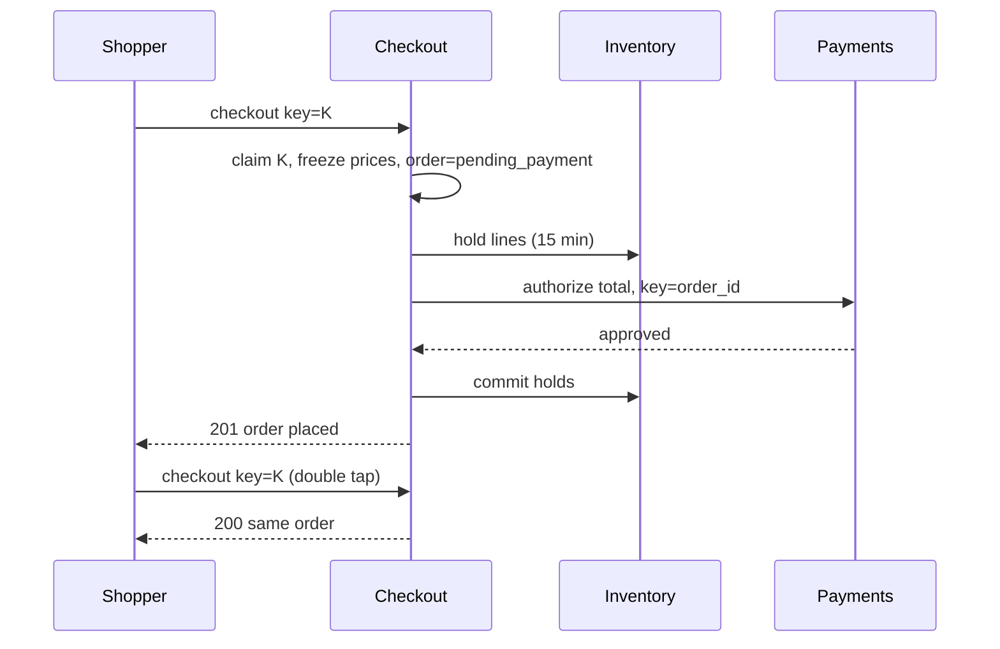
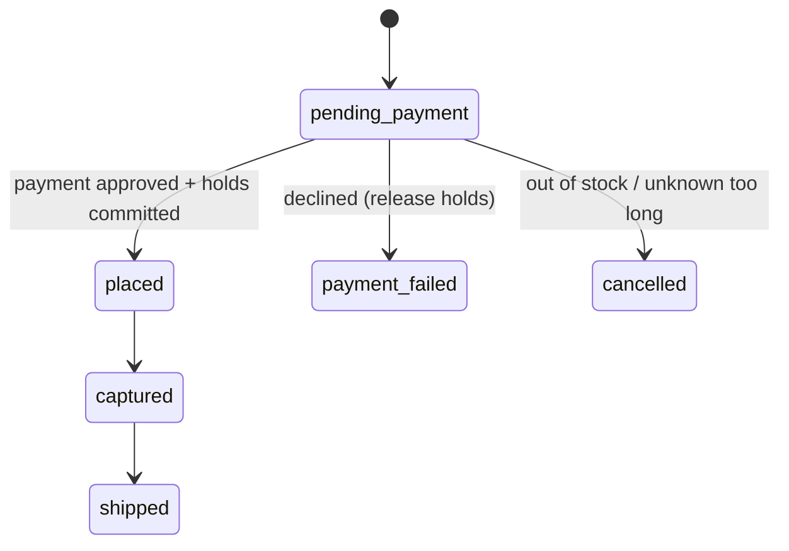

<!-- day-nav -->
[← Day 68 — File sync](68-file-sync.md) · [Day 70 — Flash sale →](70-flash-sale.md)

# Day 69 — Cart and checkout

**Do now**

1. Set a timer.
2. Attempt the problem. Stop at the attempt line. Do not scroll.
3. Then read.

## Time box

40 minutes.

| Minutes | Do this |
|---|---|
| 0–12 | Attempt. Snapshot price, hold stock, checkout idempotent. No double charge or double commit. |
| 12–32 | Read. Tie to days 49/61/65 without redesigning them. Day 70 is the spike queue. |
| 32–40 | Say checkout steps, idempotency, and what stale prices do. |

## Intent

Facing a purchase, leave able to snapshot price and hold stock so a retry cannot double-charge or double-commit inventory.

## Problem

> Design cart and checkout.
>
> A shopper adds items to a cart and checks out. Price and stock can change while they browse. A retry must not charge twice or take inventory twice.

## Attempt before reading

12 minutes. Do not scroll.

Write:

1. Cart vs order: when does price freeze?
2. Stock: soft hold vs commit (day 49).
3. Payment authorize/capture (day 65) order of steps.
4. Idempotency key on checkout.
5. Partial failure: paid but not reserved / reserved but not paid.

---

**Stop. Checkout creates an order with price snapshot + stock hold + payment, all idempotent.**

---

## Requirements

**In.** A cart the shopper can change freely. Checkout turns the cart into an order with frozen line prices, tax and shipping, a stock hold, and a payment. Order states the shopper and support can see. Guest carts and signed-in carts.

**Assumptions.** **500** checkouts/s at peak, about **3** lines per cart. Cart reads and edits run 10–20× higher than checkouts. One region. Card and UPI payments, so some payments finish in seconds and some take minutes (a one-time password, or approving a UPI request in another app).

**Out.** The flash-sale waiting room (day 70), picking the best warehouse, and a deep promotions engine. Treat a coupon as one more line with a frozen amount.

## Estimates

- **Stock holds.** 500 checkouts/s × 3 lines = **1,500** hold writes/s at peak. Spread across many items, that's easy. The hard case is one hot item, which is day 70's problem.
- **Idempotency records.** One per checkout attempt, kept 24 hours. If the full day ran at peak: 500 × 86,400 ≈ **43 M** rows × ~1 KB ≈ **43 GB**. Real days average well below peak, so this is a ceiling, not a target.
- **Orders.** Say the day averages 100 checkouts/s: 100 × 86,400 ≈ **8.6 M** orders/day × ~2 KB ≈ **17 GB/day**. That's months of growth before the order store needs splitting.
- **Latency.** Card authorization from a payment provider usually lands in 1–3 s. Budget **5 s** for the whole synchronous path, and switch to "processing" once a payment goes asynchronous.
- **Hold lifetime.** If a one-time password or UPI approval can take a few minutes, a 60-second hold is a bug. Use about **15 minutes**, well beyond the slowest normal payment.

The number that flips the design: how long payment can stay unknown. Seconds means a simple synchronous checkout. Minutes means you need a pending order state and a background sweeper.

## API and data

```
POST /v1/carts/{cart_id}/items   {sku, qty}
POST /v1/checkout                {cart_id, idempotency_key}
  → 201 {order_id, state}         first time
  → 200 {order_id, state}         same key again
  → 409 {reason: price_changed | out_of_stock}
GET  /v1/orders/{order_id}
```

**Cart.** `cart_id, owner, lines[{sku, qty, price_seen}]`. Soft state: a key-value store or a plain table, with a TTL on guest carts. `price_seen` is only there to warn the shopper. It is never what you charge.

**Idempotency record.** `(owner, key) UNIQUE`, plus a hash of the request body, the resulting `order_id`, and the current step. Same key with a different body returns 422, so a buggy client can't reuse a key for a different cart.

**Order.** `order_id, owner, state, currency, total_minor`, then lines `{sku, qty, unit_price_minor, tax_minor, reservation_id}`, then `payment_id`. Store money as integers in the smallest unit (paise, cents). Floats round, and rounding errors show up in reconciliation (day 66).

**Order states.** `pending_payment → placed → captured → shipped`, with exits to `payment_failed` and `cancelled`. Every step change is a conditional update ("set placed where state = pending_payment"), so two workers can't both advance the same order.

## Design

### Checkout saga (day 41 shape)

1. **Claim the key.** Insert the idempotency record. If it already exists, return whatever that record points to and stop.
2. **Freeze prices.** Read current catalog prices and compare them with `price_seen`. A drop goes through at the new, lower price. A rise returns 409 `price_changed` with the new total. The shopper confirms, and the client retries with a **new** key, because it's a new purchase decision.
3. **Write the order** as `pending_payment` with the frozen prices. Now there's a durable row that every later step and every retry can find.
4. **Hold stock** for each line (day 49), with the 15-minute hold. If any line fails, release the lines you already held and mark the order `cancelled` with reason `out_of_stock`.
5. **Authorize payment** (day 65) for the frozen total, passing the `order_id` as the provider's idempotency key. A retried call then can't create a second authorization.
6. **On success:** commit the holds into real stock decrements, set the order to `placed`, and clear the cart.
7. **Capture.** Capture right away for digital goods. For physical goods, authorize now and capture at shipping. Card authorizations expire after roughly a week (it varies by card network), so a slow warehouse needs a re-authorize path.

Why this order: write the order before touching stock or money, so every failure has a row to hang its repair on. Hold stock before charging, so you never take money for goods you can't ship.

### Compensations, step by step

| Fails at | Undo |
|---|---|
| Price check | Nothing to undo. 409. |
| Stock hold | Release earlier holds. Order `cancelled`. |
| Payment declined | Release all holds. Order `payment_failed`. Shopper can retry with a new key. |
| Payment unknown (timeout) | **Do nothing yet.** Keep the holds. The sweeper asks the provider. |
| Commit after successful payment | Retry the commit (it's idempotent per `reservation_id`). Only if stock is truly gone: void or refund, then cancel. |

### The sweeper

A background job scans `pending_payment` orders older than about 60 s. It asks the provider for the payment's status using the `order_id`, then moves the order forward (`placed`) or back (`payment_failed` plus hold release). Orders still unknown after the hold lifetime get extended once, then go to a human queue. Never release stock while the payment can still succeed.

### Retries and double clicks

The client generates the key once, when the shopper lands on the review page, and reuses it for every retry of that checkout. Same key: same order, whatever step it reached. A button that makes a new key per click is how shoppers get charged twice.

### Worked numbers

A shopper's cart has 2 × ₹1,200 headphones (₹2,400) and 1 × ₹800 case. The headphones drop to ₹1,100 while they browse.

- At checkout, the price check sees ₹1,200 seen vs ₹1,100 now. Your policy: a price **drop** can go through silently at the new price, and a price **rise** returns 409. Here the order freezes at ₹2,200 + ₹800 = **₹3,000**.
- The shopper double-taps Pay. Both requests carry key K. The second finds the record and returns the same `order_id`. One authorization of ₹3,000.
- The UPI approval takes 4 minutes. The order sits in `pending_payment`. The 15-minute hold covers it, and the sweeper picks it up at 60 s and keeps polling. If the hold were 60 s, those headphones would have been resold to someone else.

## Diagrams



Caption: "The order row exists before any stock or money moves. One key, one order."



## Failure the user sees

**Paid, then stock commit fails.** Retry the commit first. If the stock really is gone, void the authorization (or refund after capture) and cancel. The shopper sees "we couldn't get this item, your money is on its way back", not a silent order that never ships.

**Payment unknown.** The shopper sees "processing, we'll confirm shortly". Holds stay. The sweeper resolves it in under a minute in the normal case.

**Double click.** Same key, same order. A new key per click is a client bug. Say it out loud.

**Price changed.** A rise gets a 409 and a confirm screen. Never charge more than the shopper saw without asking.

**Hold expires mid-payment.** This should be rare, because the hold outlives the slowest normal payment. If it happens, retry the hold. If the stock is gone, refund.

## Trade-offs

**Synchronous checkout vs pending order.** Synchronous is simpler and fine when payment finishes in seconds. Once one-time passwords or UPI enter, you need `pending_payment` and a sweeper anyway, so design for it from the start.

**Server cart vs browser cart.** A server cart follows a signed-in shopper across devices. A browser cart is cheap for guests. Either way, checkout reads the cart once and the order is the record.

**Silent reprice vs confirm.** Silent drops are friendly. Silent rises are a support ticket and, in some places, a consumer-law problem. Confirm on any rise.

**Name the refusal inside each alternative.** Against charging before holding stock: you refuse taking money for goods you can't ship. Against a new key per retry: you refuse double orders. Against rewriting order prices from the catalog later: you refuse rewriting receipts. Against releasing holds while payment is unknown: you refuse overselling when the late payment lands.

**10× checkouts.** 5,000/s × 3 lines = 15,000 hold writes/s. Split orders and idempotency records by `owner`. The saga stays the same. If the pressure is one hot item, that's day 70.

## Talking points

**If they charge then reserve.** "Then a stock failure means refunding someone who already saw a success screen. Hold first, then pay."

**If they ask saga vs two-phase commit.** "Saga with compensations, day 41. The payment provider won't join my transaction, so a two-phase commit isn't on the table."

**If they ask about price changes.** "Freeze at checkout. Drops go through, rises need a confirm. The order row never changes price after that."

**If they ask about abandoned carts.** "Carts are soft and can linger. Holds expire in 15 minutes. Orders only exist once checkout starts."

**If they ask what pages.** "Orders stuck in `pending_payment` past 15 minutes, the refund-after-pay rate, and holds that expired during payment. Each one is a shopper with money or stock in limbo."

## Say this in the room

Checkout claims an idempotency key, freezes prices into a `pending_payment` order, holds stock for 15 minutes, then authorizes payment using the order id as the provider's key. Success commits the holds and places the order. A decline releases the holds. A timeout releases nothing: a sweeper asks the provider and finishes the job. A double click with the same key returns the same order. I won't release stock while payment is still unknown, and I won't change an order's prices after checkout. Flash-sale admission is day 70 if we need it.

### Staff depth: write the order first

Juniors start with "reserve stock". Staff starts with "write a `pending_payment` order". That row is what makes every other step safe. Retries find it. The sweeper scans it. Support can read it. Compensation has an id to work from.

**The sensitive number.** How long payment can stay unknown. It sets the hold lifetime, the sweeper interval, and whether checkout is synchronous at all.

**What staff sounds like.** Saga steps in order, the undo for each one, "unknown is not failure", and the client-owned idempotency key.

### More probes, with the answer

**"Two tabs, same cart, both check out?"** Two keys, so two orders could start. The stock hold settles it for scarce items. For plenty of stock, both orders are real purchases, and that's fine. Optionally lock the cart while a checkout on it is in progress.

**"Why not use the cart id as the key?"** Because the shopper may check out the same cart, fail on a declined card, then retry with a different card. That's a new attempt and needs a new key.

**"How do you test this?"** Kill the checkout worker after each step and confirm the sweeper drives every order to a final state with stock and money matching.

## Kit artifact

| Follow-up | You answer with |
|---|---|
| "Double charge?" | Client-owned checkout key, plus `order_id` as the provider's key. Same order back. |
| "Payment times out?" | Order stays `pending_payment`, holds stay, sweeper asks the provider. |
| "Price changed?" | Freeze at checkout. Drops pass, rises need a confirm. |
| "Paid but out of stock?" | Retry the commit, then void or refund and cancel. |

## Design log

One line: your step order, and what happens to stock when payment times out.

Next: [Day 70 — Flash sale](70-flash-sale.md). Queue buyers; fairness; protect the DB.

---

<!-- day-nav -->
[← Day 68 — File sync](68-file-sync.md) · [Day 70 — Flash sale →](70-flash-sale.md)
