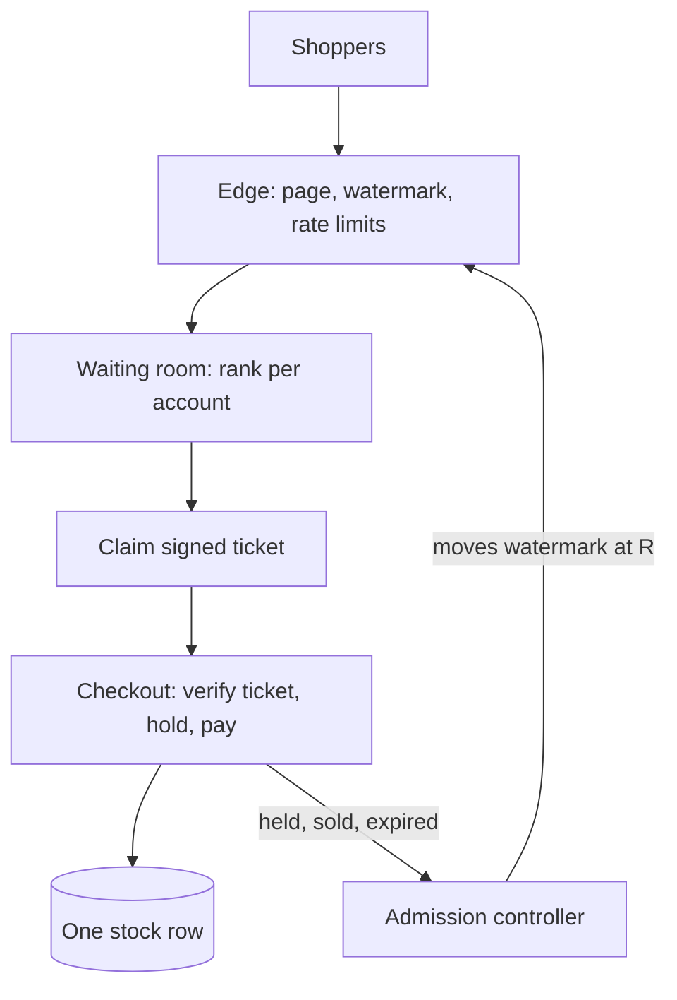

<!-- day-nav -->
[← Day 69 — Cart and checkout](69-cart-and-checkout.md) · [Day 71 — Social graph →](71-social-graph.md)

# Day 70 — Flash sale

**Do now**

1. Set a timer.
2. Attempt the problem. Stop at the attempt line. Do not scroll.
3. Then read.

## Time box

40 minutes.

| Minutes | Do this |
|---|---|
| 0–12 | Attempt. Arrival spike on scarce stock. Queue with fairness — do not pile onto the DB. |
| 12–32 | Read. Day 49/61 conditional writes are not enough at this QPS. Day 69 checkout sits behind the queue. |
| 32–40 | Say admit rate, fairness rule, and what the shopper sees while waiting. |

## Intent

Facing an arrival spike on scarce stock, leave able to queue buyers with a fairness rule instead of letting them pile onto the database.

## Problem

> Design a flash sale.
>
> A scarce item goes on sale at a set time. Far more shoppers arrive than stock can serve. The system must stay up and apply a fairness rule you can state.

## Attempt before reading

12 minutes. Do not scroll.

Write:

1. Peak arrival vs stock and vs DB write ceiling.
2. Waiting room / queue: who gets an admit ticket.
3. Fairness: FIFO, lottery, loyalty — pick and cost.
4. What happens behind the ticket (reserve + checkout).
5. Bots and multi-tab.

---

**Stop. Admission control in front. Tickets. Bounded reserve QPS. Named fairness.**

---

## Requirements

**In.** One item, **N = 10,000** units, start time known in advance. **100k–1M** shoppers arrive around the start. A waiting room in front of checkout. An admitted shopper gets a ticket: the right to try checkout once, within **T = 10 minutes**. Limit **one unit per account**. A fairness rule you can say in one sentence.

**Assumptions.** A conditional write on one inventory row tops out around **500/s** (Day 49). Arrivals beat that by 100× or more. One region, static pages on a CDN. Payment is the Day 69 checkout, unchanged.

**Out.** Redesigning payments, dynamic pricing, multi-item carts, resale markets.

## Estimates

- **Join burst.** If 1M people press "join" within ~10 s of the start, the room takes **~100k joins/s**. That's fine, because a join never touches stock. Partition the room by user id and it scales sideways.
- **Status polls.** 1M waiters polling every 5 s is **200k reads/s**. Don't answer each one from a database. Publish one number, "now admitting up to rank X," about once a second. The client computes its own position as `my_rank − X`. Every poll becomes a CDN cache hit on one tiny object.
- **Admits needed.** Not everyone admitted buys. If **60%** of admitted shoppers finish payment inside T, selling 10k units needs about **10,000 / 0.6 ≈ 16.7k** admits.
- **Admit rate.** Set **R ≈ 300/s**, well under the 500/s row ceiling, leaving room for retries and releases. 16.7k admits at 300/s takes **~56 s**. The scarce part of the sale is over in about a minute.
- **Tail.** Unpaid holds expire after T, so a trickle of returned units comes back 10 minutes later. Plan a second, smaller admit wave, not a reopened floodgate.

## API and data

- `POST /v1/sales/{id}/join` → `{rank, state}`. Idempotent per `(sale, user)`. Ten tabs get the same rank.
- `GET /v1/sales/{id}/watermark` → `{admitted_up_to, sold_out}`. Cached at the CDN for ~1 s.
- `POST /v1/sales/{id}/claim` with the ticket → returns a signed ticket once `rank ≤ admitted_up_to`.
- `POST /v1/checkout` with the ticket → reserve, pay, commit (Day 69).

**Ticket.** A signed token (HMAC or similar) holding `user`, `sale`, `rank`, `expires_at`. Checkout checks the signature without calling the room, so a room outage can't block shoppers already admitted.

**Hold row.** `(sale, user)` primary key, `state` (held, paid, expired), `expires_at`. The unique key gives you one unit per account and single use for free.

**Stock row.** `remaining`. Decrement only with `UPDATE … SET remaining = remaining − 1 WHERE remaining > 0`.

## Design

### Layers

1. **Edge.** Serves the static sale page and the watermark. Applies per-IP and per-account rate limits plus bot checks.
2. **Waiting room.** Assigns a rank on join. Holds no stock and never calls inventory.
3. **Admission controller.** One small service that moves the watermark forward at rate R, and only while unheld stock remains.
4. **Checkout.** Verify the ticket, insert the hold row, decrement stock, pay, mark paid (Day 69).

### Fairness: pick one rule and say its cost

- **FIFO by join time.** Feels fair. Rewards whoever hits the button first, which usually means bots and people closest to the servers.
- **Lottery.** Open a join window, say 15 minutes before the start. Everyone who joins in the window gets a random rank at the start. Late joiners line up FIFO behind the lottery block.
- **Loyalty or member priority.** A product choice. If you use it, say so out loud.

Pick the **per-account lottery with a pre-start window**. It also fixes the load problem: the join spike spreads over 15 minutes instead of landing in one second, because nobody gains by refreshing at the exact start.

### The admission controller

The controller reacts to live numbers. It never runs at a fixed rate.

- Admit while `held + sold < N`. Stop the moment it equals N.
- When a hold expires, it returns one unit and the controller admits one more rank.
- If checkout latency or error rate climbs, slow R. The stock row is the bottleneck, so protect it first.
- **Sold out** means `sold = N` and no live holds. Before that, waiters see "all units are held; you may still get one if a hold expires." That's honest, and it stops a stampede of refreshes.

### Why sharding the stock counter is the wrong fix

The tempting move: split 10,000 units into 10 shards of 1,000 so writes spread out.

- **With a hard cap per shard,** you can't oversell. But traffic is never even. One shard sells out while others still have stock. Shoppers routed there see "sold out" while units sit unsold.
- **Fixing that** means shards borrow from each other near the end. That's a coordination protocol on the hottest path of the sale.
- **Without hard caps,** shards check a shared "remaining" that's stale by the time they write. That's where real oversell comes from.

Admission control makes all of this unnecessary. R ≈ 300/s fits one row with headroom, so the answer is one counter, one row, bounded traffic.

**Faster counter, new risk.** An in-memory atomic counter (one Redis key, for example) takes far more writes per second than a database row. If you use one, the database stays the source of truth. A failover can lose recent decrements, so reconcile counts against hold rows and cap oversell with a stop rule.

### Bots and multi-tab

- **One rank per account.** Join is idempotent, so extra tabs and devices change nothing.
- **Tickets are bound to the account.** A ticket scraped or shared from another account fails the signature check.
- **Raise the cost of fake accounts.** Account age, verified phone, or a past purchase as join conditions. These are product calls; name them, don't promise they stop every bot.

### Failure

- **Room down at the start.** Shed new joins with `Retry-After`. Never open the stock path directly. Shoppers already holding signed tickets keep checking out.
- **Controller down.** The watermark freezes. Nobody new gets in, and stock stays safe. Restart from durable state: watermark, held count, sold count.
- **Checkout slow.** Holds pile up and expire, and units recycle. The controller sees the error rate and slows R.
- **Clocks.** Ticket and hold expiry use server time with a small grace window, never the client's clock.

### Worked numbers

| Quantity | Value | Where it comes from |
|---|---|---|
| Stock N | 10,000 | Problem |
| Join peak | ~100k/s | 1M joins in ~10 s |
| Status reads | ~200k/s | 1M waiters, 5 s poll, all CDN hits |
| Row ceiling | ~500/s | Day 49 |
| Admit rate R | ~300/s | Ceiling minus headroom |
| Payment success | 60% | Assumption; measure it |
| Admits needed | ~16.7k | 10,000 / 0.6 |
| First wave | ~56 s | 16.7k / 300 |
| Second wave | after T = 10 min | Expired holds return units |

## Diagrams

Caption: "The crowd hits the edge and the room. Only R per second reaches the stock row."

## Failure the user sees

**Everyone hits inventory.** No room in front. The database melts, most shoppers get errors, and a few lucky requests slip through. That's chaos, not fairness.

**Bots win.** FIFO with no account limits. Scripts take the stock in the first second.

**Stranded stock.** Sharded counters with hard caps. A shopper sees "sold out" while another shard still holds units.

**Oversell.** Uncapped shards, or an in-memory counter that lost decrements on failover. You sell items you can't ship, then cancel and apologize.

**Ticket, then nothing.** A valid ticket arrives after the last hold is taken. Expected. Say so clearly, and keep the ticket TTL short.

**Fake "sold out."** A 503 during the join spike shown as "sold out." Shoppers leave while stock remains.

## Trade-offs

**Lottery vs FIFO.** Lottery resists bots and flattens the spike. FIFO feels fairer to people who showed up early. Pick one and say it.

**Hard stop vs small oversell.** A hard stop can leave a few units unsold while holds expire. Allowing oversell needs a cancellation budget and an apology flow.

**Short vs long ticket TTL.** Short TTL recycles stock faster but punishes slow payers. Long TTL is kinder and leaves stock locked longer.

**Name the refusal inside each alternative.** Against open checkout at arrival rate: you refuse melting the stock row. Against sharded counters: you refuse stranded stock or oversell. Against 503 shown as sold out: you refuse fake scarcity. Against "first request wins" with no tickets: you refuse handing the sale to bots and calling it fair.

**10× arrivals.** The room and the edge grow. R stays the same. Stock correctness doesn't change at all.

## Talking points

**If they shard the counter.** "Capped shards strand stock under skew, and uncapped shards oversell. I keep one row and bound the traffic instead."

**If they ask fairness.** "Per-account lottery over a pre-start window. It resists bots and spreads the join spike."

**If they ask position updates.** "One cached watermark. The client subtracts. No per-user reads."

**If they ask sold out vs busy.** "Different codes. `Retry-After` for busy. Sold out only when sold equals N and no holds are live."

**If they ask bots.** "One rank per account, account-bound tickets, and costs on fake accounts. The ticket bound holds even when bot checks miss."

**If they ask what pages.** "Join error rate, reserve rate against the row ceiling, hold expiry rate, oversell count. Oversell above zero pages someone."

## Say this in the room

A flash sale puts admission control in front of inventory, so a million arrivals become about 300 stock writes a second on one row. I rank shoppers with a per-account lottery over a pre-start window, publish one cached watermark for positions, and hand out signed tickets that checkout verifies on its own. I won't shard the stock counter: capped shards strand stock and uncapped ones oversell. Sold out and busy are different answers. Expired holds return stock, and the controller admits more. Checkout underneath is Day 69.

### Staff depth: the admission controller is the design

Everything else is standard parts. The controller decides how many people reach the stock row and when to stop. Say its inputs (held, sold, expiry, checkout errors), its output (the watermark), and its stop rule (`held + sold = N`).

**Fairness.** One sentence: who gets a rank, how, and what it costs.

**What staff sounds like.** Admission before stock. Watermark instead of per-user polling. One row, bounded traffic. Honest sold-out.

### More probes, with the answer

**"Why not just add database capacity?"** One item is one row. More replicas don't speed up writes to a single row. Bounding traffic does.

**"What if payment success drops to 30%?"** You need ~33k admits for 10k units. The controller keeps admitting as holds expire. Measure the rate live; don't hardcode it.

**"Can a shopper keep their spot if they refresh?"** Yes. Join is idempotent per account, so refresh returns the same rank.

**"What's the sensitive assumption?"** Payment success inside T. Wrong by 2×, and you either admit too few (unsold stock, long tail) or too many (crowded checkout, angry ticket holders).

## Kit artifact

| Follow-up | You answer with |
|---|---|
| "Why not just shard stock?" | Capped shards strand stock under skew, and uncapped shards oversell. Bound the traffic and keep one row. |
| "How do 1M people see their position?" | One cached watermark every ~1 s. Position = my rank − watermark, done on the client. |
| "When do you say sold out?" | When sold = N and no holds are live. Before that, "all held, may free up." |
| "What stops bots?" | One rank per account, account-bound signed tickets, and costs on fake accounts. |

## Design log

One line: your fairness rule, your admit rate against the row ceiling, and your stop rule.

Next: [Day 71 — Social graph](71-social-graph.md). Follow, block, privacy on the read path.

---

<!-- day-nav -->
[← Day 69 — Cart and checkout](69-cart-and-checkout.md) · [Day 71 — Social graph →](71-social-graph.md)
