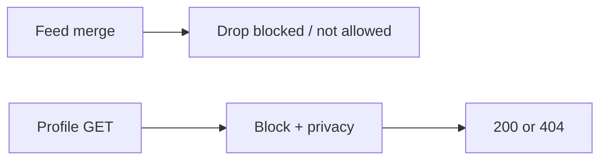
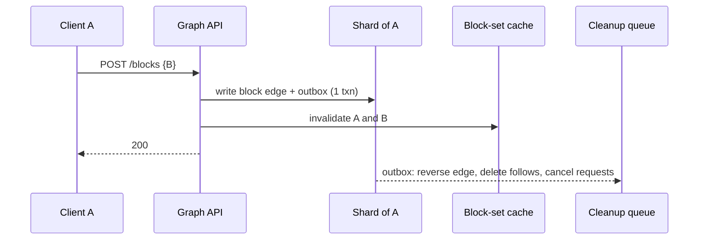

<!-- day-nav -->
[← Day 70 — Flash sale](70-flash-sale.md) · [Day 72 — Ephemeral stories →](72-ephemeral-stories.md)

# Day 71 — Social graph

**Do now**

1. Set a timer.
2. Attempt the problem. Stop at the attempt line. Do not scroll.
3. Then read.

## Time box

35 minutes.

| Minutes | Do this |
|---|---|
| 0–10 | Attempt. Follow and block. Privacy check correct on the read path. |
| 10–28 | Read. Block is not unfollow. Fan-out must honor privacy. |
| 28–35 | Say edge types, indexes, and where block is enforced. |

## Intent

Facing follow and block, leave able to store the graph so a privacy check stays correct on the read path.

## Problem

> Design a social graph.
>
> People follow each other. They can block. Feeds and profile views must respect blocks and private accounts.

## Attempt before reading

10 minutes. Do not scroll.

Write:

1. Edge types: follow, block; direction.
2. Private account + follow request (thin).
3. Where feed (day 51) checks block.
4. Hot celebrity follower list storage.
5. Consistency: unfollow visible how fast?

---

**Stop. Dual indexes for graph walks. Block checked on read and on write fan-out. Bound lag.**

---

## Requirements

**In.** Follow/unfollow, block/unblock, private accounts with approve/deny. Queries: followers of X, who X follows, is-blocked?, can-view?

**Assumptions.** **100M** users; **200M** follow edges; **~20M** block edges. A celebrity has **50M** followers. Never load a full list in one response.

**Out.** Friend ranking, suggestion ML, multi-hop graph search (friends-of-friends is an offline batch job, not a live query here).

## Estimates

- **Writes.** Follow/unfollow **1k/s** peak. Blocks are far rarer, but each one triggers cleanup work.
- **Reads.** Every feed load, profile view, DM, and search card asks "can this viewer see this author?" That's easily **100× the write rate**. Plan for **100k+ checks/s**.
- **Storage.** An edge row is `src 8B + dst 8B + type 1B + state 1B + created_at 8B` ≈ **26 B**. Call it ~64 B with index overhead. Forward plus reverse is 2 rows per follow: 200M × 2 × 64 B ≈ **26 GB**. Add blocks and you're still under **30 GB**.
- **The staff point.** The whole graph fits on a handful of machines. You shard for **hot keys and write spread**, not because the data is big.

## API and data

```
POST   /v1/follows        {target}         -> 201 active | 202 pending
DELETE /v1/follows/{target}
POST   /v1/blocks         {target}
DELETE /v1/blocks/{target}
GET    /v1/users/{id}/followers?cursor=…&limit=1000
GET    /v1/users/{id}/following?cursor=…&limit=1000
```

Two tables, same shape, different shard key:

| Table | Key | Sharded by | Answers |
|---|---|---|---|
| `edges_out` | `(src, type, dst)` | `src` | "Who do I follow / block?" "Am I following X?" |
| `edges_in` | `(dst, type, created_at, src)` | `dst` | "Who follows X?" (newest first, paged) |

`state` is `active` or `pending` (private-account requests). Block edges live in the same tables with `type=block`.

## Design

### Storage: adjacency lists, not a graph database

Every query here is **one hop**: my followers, my following, is A blocking B. Sharded adjacency lists in a key-value or SQL store answer one hop in a single indexed range read. Facebook's TAO and Twitter's FlockDB are both built this way. A general graph database earns its keep on multi-hop traversals, and you've scoped those out.

### Writes: forward is truth, reverse follows

The forward row sits on `src`'s shard and the reverse row sits on `dst`'s shard. That's two machines, so there's no cheap atomic write.

1. Write `edges_out` plus an outbox event in **one local transaction** on `src`'s shard.
2. A worker reads the outbox and upserts `edges_in` on `dst`'s shard. Make it idempotent, since replays are normal.
3. A repair job compares the two sides and fixes any hanging reverse edge.

What this buys you: "Am I following X?" reads the forward side, so the person who just tapped Follow sees it at once. "Followers of X" may lag a second or two, and nobody notices. The TAO paper describes the same trade: inverse edges aren't written atomically, and a background job repairs the ones left hanging.

### Block: write the edge first, clean up after

Block(A→B) means A doesn't see B, B doesn't see A, and neither can message the other. The order matters:

1. **Write the block edge** (forward and reverse, same as a follow). This is now the source of truth.
2. **Invalidate** the cached block sets for **both** A and B. Do it synchronously, before you return 200.
3. **Queue cleanup**: delete A→B and B→A follows, cancel pending requests, stop notifications. This is idempotent and retried.
4. **Leave old feed inbox rows alone.** The read filter hides them, and trim removes them later.

If step 3 lags, nothing leaks, because every read checks the block edge. If you did it the other way round (unfollow first, block later), a crash in between leaves B following A with no block. That's a privacy bug.

**Unblock** deletes the block edge and invalidates both caches. It does **not** restore old follows. Say that out loud, because it's a product rule interviewers like to probe.

### Read path: one block-set fetch per request, not one per author

A feed merge (day 51) might pull 500 candidate posts from 200 authors. Two hundred pair lookups per feed load is wasteful.

- On each request, load the viewer's **block set** once: everyone they block, plus everyone who blocks them. Most users have zero to a few dozen entries. Cache it per viewer.
- Filter candidates in memory: O(1) per author.
- For heavy blockers, keep a per-viewer **Bloom filter** over the block set. At 1% false positives that's ~9.6 bits per entry. A Bloom miss means "definitely not blocked." A Bloom hit means "maybe," so confirm with an exact lookup before you hide anything.

Enforce the same `can_view(viewer, author)` check on **profile GET, feed merge, DM create, search cards, and comment threads**. One shared function, called from every surface. A surface that skips it is where the leak shows up.

### Private accounts and follow requests

- A follow to a private account writes `state=pending`. Fan-out (day 51) treats pending as **not following**.
- **Approve** flips the state to `active` and optionally backfills the last N posts into the new follower's inbox.
- **Deny** deletes the edge. Rate-limit follow requests per sender to stop request spam.
- **Public → private flip:** `can_view` is per viewer, so never CDN-cache a private profile's content as public. Purge any cached public renderings on the flip.

### Celebrity lists and counts

- 50M followers × 8 B ids = **400 MB**. One page of 1,000 is **8 KB**. Always page.
- Use **keyset cursors**: `WHERE dst=X AND (created_at, src) < (cursor)`, `ORDER BY created_at DESC, src DESC`, `LIMIT 1000`. `OFFSET 40,000,000` makes the database walk 40M rows to skip them.
- **Follower count** is a stored counter, not `COUNT(*)`. Split a hot celebrity's counter into N sub-counters and sum them on read. Showing "50.2M" lets you serve a slightly stale count with no harm done.
- A celebrity's reverse rows all land on one `dst` shard. When they go viral, that shard takes the write spike. The outbox buffers it, so followers appear in the list a little late while the follow itself succeeded instantly.

### Staff arithmetic: what actually costs money

The graph is **~30 GB**, so storage is cheap. Reads are the cost: 100k+ `can_view` checks a second. One cached block set per request turns 200 lookups into 1. The block lag SLO is **seconds**, and you meet it with synchronous cache invalidation plus a read filter, not with a short TTL. Unfollow can lag because filter-on-read covers it. Block can't, so it gets the synchronous path.

## Diagrams



Caption: "Privacy is on the read path, not only on write."



Caption: "Block edge first, caches cleared before 200, cleanup after. A cleanup crash leaks nothing because reads check the edge."

## Failure the user sees

**Blocked user still in feed for 10 minutes.** You relied on a TTL instead of invalidation. Fix: synchronous invalidate of both block sets, with the read filter as the backstop. Both are required.

**Block raced an in-flight fan-out.** A fan-out worker read the graph before the block and wrote B's post into A's inbox afterwards. The read filter hides it. This is exactly why the inbox is never trusted on its own.

**Hanging reverse edge.** The forward write committed, the reverse worker died, and X's follower list is missing someone. The outbox replays it, and the repair job catches the rest. User-visible: a follower count off by one for seconds.

**404 vs 403 on private/blocked profiles.** A 403 confirms the account exists, so it acts as an existence oracle. Many products return 404 to a blocked viewer. Pick one rule and apply it on every surface.

**Celebrity follower dump.** The API tries to return 50M ids and times out or runs out of memory. Keyset pages only.

**Pending follow sees posts.** Fan-out treated `pending` as `active`. Gate fan-out on `state=active`.

**Unblock restores old follows.** Surprising and creepy. Unblock clears the block only.

## Trade-offs

**Check on read vs materialized allow-lists.** Check on read with a cached block set. Materialize only for one proven hot path, and keep the read check anyway.

**Adjacency lists vs graph database.** Lists for one hop at this scale. A graph DB only if multi-hop queries move online.

**Atomic cross-shard write vs outbox + repair.** A distributed transaction on every follow adds latency and coordination for a reverse list nobody reads within a second. Use the outbox, and make the forward side the truth.

**Name the refusal inside each alternative.** Against block = unfollow: you refuse one-way hide without two-way privacy. Against an hour-long block TTL: you refuse a privacy SLO measured in hours. Against a full celebrity dump: you refuse an unbounded response. Against fan-out on pending follows: you refuse to leak posts to people the owner never approved. Against a 403 that reveals existence: you refuse the oracle.

**10× follows.** That's ~260 GB, still small. Add shards for write spread. The block-set cache and celebrity page size stay the same.

## Talking points

**If block = unfollow.** "Not enough. Block is two-way, hides on every surface, and invalidates caches before I return."

**If they ask where the feed checks.** "Merge filter on read (day 51), plus a write-side skip on fan-out when we already know. The read path is the safety net."

**If they ask about cross-shard consistency.** "Forward edge plus outbox in one local transaction. The reverse side is eventually consistent, with a repair job. The person who followed sees it immediately."

**If they ask about unfollow lag.** "Filter on read. Stale inbox rows are fine until trim. Block gets the tight path."

**If they ask about private accounts.** "Pending edges don't fan out. Approve flips to active and can backfill."

**If they ask what pages.** "Block-invalidate failures, outbox lag on the reverse index, can-view p99, and follower-list page p99."

## Say this in the room

The graph is small, about 30 GB with forward and reverse adjacency lists, so I shard for hot keys and reads, not size. Follows write the forward edge plus an outbox event in one local transaction, and the reverse index catches up within seconds, with a repair job behind it. Block writes its edge first, invalidates both users' block sets before returning, then cleans up follows asynchronously, so a crash never leaks. Every surface calls one `can_view` check that loads the viewer's block set once per request. Celebrity lists use keyset pages and sharded counters. Unfollow may lag. Block may not.

### Staff depth: the block edge is the truth, everything else is cleanup

Block edge first, caches cleared before 200, follows removed after. One `can_view` function on every surface. Block ≠ unfollow, and unblock ≠ refollow. 404 vs 403: pick one and stick to it.

**Dual indexes.** Forward for "who I follow" (read-your-writes). Reverse for "followers of" (paged, eventually consistent).

**What staff sounds like.** "The data is 30 GB, the reads are the cost." "Write order makes a crash safe." "Refuse block = unfollow."

### More probes, with the answer

**"What if the cleanup worker is down for an hour?"** Nothing leaks. Reads check the block edge. The follow rows are stale for an hour, and counts are off until cleanup runs.

**"Mutual follows / friends?"** Two forward lookups, A→B and B→A, or a `mutual` flag kept by the follow worker.

**"What is the sensitive assumption?"** The read-to-write ratio. If can-view checks run at 1M/s instead of 100k/s, block-set caching moves from nice to mandatory, and so does a per-region cache.

## Worked numbers you can reuse

| Quantity | Value | Why it matters |
|---|---|---|
| Edge row with index overhead | ~64 B | Sizing |
| 200M follows, both directions | ~26 GB | Small: shard for heat, not size |
| Celebrity follower ids | 50M × 8 B = 400 MB | Never one response |
| One follower page | 1,000 × 8 B = 8 KB | Keyset cursor |
| Feed block checks | 200 authors → 1 block-set fetch | Per-request cache |
| Bloom filter, 1% false positive | ~9.6 bits per entry | Maybe → exact check |
| Block lag SLO | seconds | Sync invalidate + read filter |

## Kit artifact

| Follow-up | You answer with |
|---|---|
| "Still seeing them after block?" | Invalidate + feed filter; SLO seconds, not TTL hours. |
| "Forward and reverse out of sync?" | Forward + outbox in one local txn; reverse catches up; repair job. |
| "Celebrity follower list?" | Keyset pages of 1,000; sharded counter for the count. |
| "Crash halfway through a block?" | Block edge written first, so reads hide; cleanup retries. |

## Design log

One line: where block is enforced on read, the lag bound you stated, and the write order for block.

Next: [Day 72 — Ephemeral stories](72-ephemeral-stories.md). Fan-out with real TTL.

---

<!-- day-nav -->
[← Day 70 — Flash sale](70-flash-sale.md) · [Day 72 — Ephemeral stories →](72-ephemeral-stories.md)
