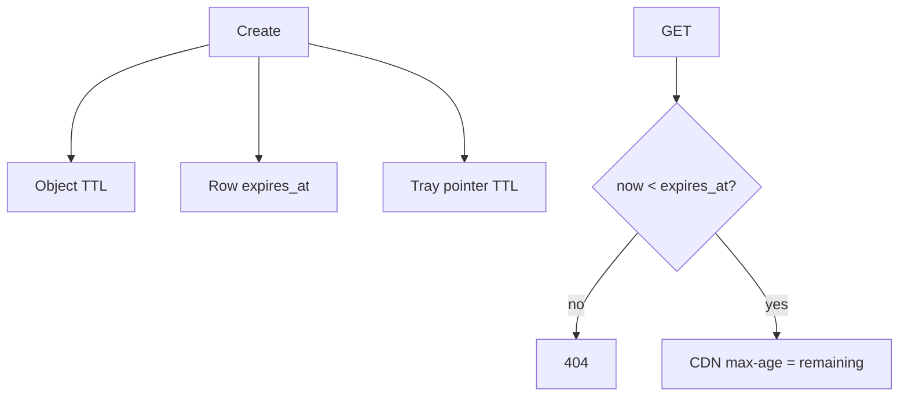
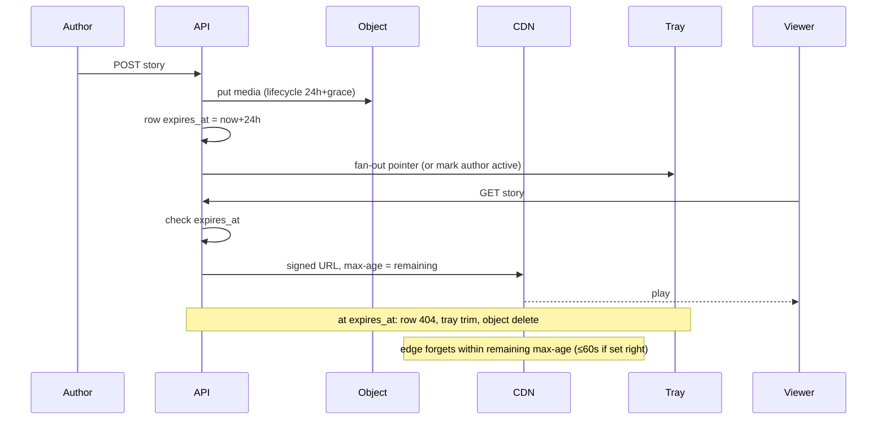

<!-- day-nav -->
[← Day 71 — Social graph](71-social-graph.md) · [Day 73 — Web crawler →](73-web-crawler.md)

# Day 72 — Ephemeral stories

**Do now**

1. Set a timer.
2. Attempt the problem. Stop at the attempt line. Do not scroll.
3. Then read.

## Time box

35 minutes.

| Minutes | Do this |
|---|---|
| 0–10 | Attempt. Posts that disappear. Fan-out with TTL real in storage and caches. |
| 10–28 | Read. UI hiding is not deletion. CDN and inbox must expire. |
| 28–35 | Say TTL in every layer that can resurrect a story. |

## Intent

Facing posts that must disappear, leave able to fan them out with a TTL that is real in storage and caches, not only in the UI.

## Problem

> Design ephemeral stories.
>
> People post stories that should vanish after a fixed time (for example 24 hours). Viewers see them until then. After expiry they must not remain readable via API, cache, or CDN.

## Attempt before reading

10 minutes. Do not scroll.

Write:

1. Create path and fan-out (day 51/52).
2. Where media bytes live; CDN cache headers.
3. Inbox pointers TTL vs media TTL.
4. Screenshot / download — product honesty.
5. After expiry: GET returns what?

---

**Stop. Expiry in row, object lifecycle, cache max-age, and fan-out trim — all four.**

---

## Requirements

**In.** Story create with media; followers view for **24 h** from create. Active viewer list thin. After expiry: **404** same as missing. Delete early by owner.

**Assumptions.** **50M** stories/day; media **2 MB** mean; fan-out hybrid as feed (day 51/52). Story TTL **24 h**; object grace **+1 h** for clock skew; CDN remaining-TTL cap **≤ 60 s** after the last refresh.

**Out.** Permanently archived highlights (separate product), ML ranking of story order, DRM against screenshots.

## Estimates

50e6 × 2 MB = **100 TB/day** ingest if every story carries mean media — heavy. Shorter clips and text-only cut that. Object lifecycle deletes after 24 h + grace. Fan-out pointers are cheap next to media bytes.

**Staff arithmetic: four clocks and the bytes behind them.** At **50M** stories/day you ingest about **100 TB/day** of media if the 2 MB mean holds. That is ~**1.16 GB/s** sustained write into object storage — size the put path and multipart before debating tray schema. Pointers into follower trays are ~100 B each; even a 500-follower push is 50 KB of fan-out, not 2 MB × 500. Celebrity authors with millions of followers must **pull** (day 52), not push millions of inbox rows per story.

CDN `max-age` must be `min(remaining_TTL, 60s)` at publish and on every refresh — never a fixed 24 h header from create time. Example: story created at T0, read at T0+23h50m → remaining 10 minutes → `max-age ≤ 600` (and still prefer ≤ 60 s near the edge). After expiry, a correctly set remaining-TTL means the edge forgets within **≤ 60 s**. Signed URL TTL should be **shorter than remaining story TTL** (e.g. 5–15 min, refreshed on play) so a leaked URL dies before the story clock.

Sweeper lag is a product SLO. If row delete runs every 5 minutes and object lifecycle is hourly, you can still serve a stale pointer until the read path checks `expires_at`. Bound trim lag (e.g. tray sweeper **≤ 5 min** p99) and page on `served_after_expiry` rate — that metric should sit near **0**.

## API and data

`POST /v1/stories` → 201 with `expires_at`. `GET` story if unexpired else **404**. Edge list of active stories per followees (tray or pull author active set).

Row: `expires_at`. Object: private bucket + lifecycle matching expiry + grace for clock skew. Play returns a **signed URL**, never a bare bucket URL.

**What you refuse on the wire.** Fixed `Cache-Control: max-age=86400` at publish. Public bucket objects. Exact view-count writes on the play path. Push fan-out for celebrity authors.

## Design

### Create

Store media; write row with `expires_at`; fan-out a pointer with the same expiry into follower story trays — or register the story in the author's active set for pull readers.

### Read

Check `expires_at <= now` → 404 before any signed URL. CDN: `max-age` ≤ remaining TTL (cap with 60 s near expiry). Signed URLs expire on their own shorter clock.

### After expiry

Sweeper deletes rows and objects; tray trim drops dead ids. CDN may still hit until max-age — bound ≤ 60 s after expiry if remaining-TTL was set correctly. Bug: fixed long max-age resurrects stories — refuse that header.

### Honesty

Clients can screenshot. Server TTL is not DRM. Say it in the room.

### Celebrity

Same bomb as day 52. Huge authors: followers **pull** the author's active story set. Ordinary authors: push pointers into trays and trim hard at expiry.

### Staff arithmetic: four clocks of expiry

Stories die in **~24 h**. Expiry must hit (1) row `expires_at`, (2) object lifecycle/delete, (3) cache/CDN max-age ≤ remaining TTL, (4) fan-out inbox trim — miss any one and a "expired" story still plays. Fan-out is day 51/52 shaped but with aggressive trim. Views counters are approximate; exact view ledgers are a different product on the hottest keys.

**Grace vs resurrection.** Object grace (+1 h) covers clock skew and late multipart completes. It does **not** mean the API keeps serving — the row gate returns 404 at `expires_at`. Grace only stops you from deleting bytes a straggler put still needs.

## Diagrams

Caption: "Every layer carries the same deadline. UI hide alone is not enough."

Caption: "Create, play, and expire share one deadline across row, object, CDN, and tray."

## Failure the user sees

**Expired story still plays.** CDN/cache max-age too long, or object not deleted, or inbox still has the id without an expiry check on read. Fix all four clocks. Page on `served_after_expiry` — target ~0.

**Story vanishes early.** Clock skew between writers and readers, or aggressive trim before `expires_at`. Bound skew; sweeper must key off `expires_at`, not "created + 23 h" guesses.

**Celebrity story fan-out.** Pushing to millions of trays is day 52's bomb. Pull for huge authors; keep push for the long tail.

**View count exact on read path.** Write amplification on a viral story. Refuse exact on play; sample or async ledger.

**Delete by owner.** Must tombstone before caches die. Same honesty as pastebin delete vs edge — bound the max-age, purge or wait.

**Signed URL outlives the story.** Leaked play URL still works after expiry. Cap signed TTL below remaining story TTL; refuse bare public objects.

**Sweeper lag piles orphan pointers.** Trays list dead ids; clients hammer 404. Bound trim lag (e.g. ≤ 5 min p99) and filter on read anyway.

## Trade-offs

**TTL in row vs bucket lifecycle only.** Both. Row gates reads. Bucket cleans bytes.

**Push trays vs pull author set.** Push for normal authors; pull for celebrities. Hybrid is the feed answer (day 51/52) with harder trim.

**Name the refusal inside each alternative.** Against CDN max-age 24h fixed at publish: you refuse serving after expiry when remaining TTL was 1 minute. Against exact view counters on the read path: you refuse a write storm. Against push fan-out for celebrity stories: you refuse day 52's bomb. Against forgetting object delete: you refuse orphan bytes and accidental resurrection via direct URL. Against signed URL TTL = story TTL: you refuse a leaked URL that outlives the product promise.

**10× stories.** Same four clocks; more trim workers; object put bandwidth scales first (100 TB/day → 1 PB/day) — say when you need more regions or colder media tiers, not a new tray store.

## Talking points

**If they only set DB TTL.** "Cache and CDN and objects too. Four clocks."

**If they ask view counts.** "Approximate. Exact is async and not on the play path."

**If they ask fan-out.** "Day 51/52 hybrid; trim hard at expiry. Celebrities pull."

**If they ask direct object URL.** "Signed short TTL URLs; bare bucket URLs refused."

**If they ask what pages.** "Served-after-expiry rate (should be ~0), trim lag, object delete lag — not only put QPS."

**If they set Cache-Control: max-age=86400 at create.** "Remaining TTL. At minute 1439 that header still serves for a day. Refuse fixed long max-age."

**If they say UI hide is enough.** "A direct GET or CDN hit still plays. Expiry is a storage and cache problem, not a CSS problem."

**If they equate grace with serving.** "Grace covers skew and late puts. API still 404s at expires_at."

## Say this in the room

Ephemeral stories expire in about a day, and that expiry has to hit the row, the object lifecycle, the cache max-age, and the fan-out trim — miss one and an expired story still plays. At fifty million stories a day and two megabytes mean media I plan for about a hundred terabytes of daily ingest; pointers stay cheap, media does not. CDN max-age is remaining TTL capped near sixty seconds, never a fixed twenty-four-hour header from publish. Fan-out follows the news-feed hybrid so celebrities pull instead of pushing millions of inbox rows. View counts are approximate; I refuse exact counters on the play path. Owner delete tombs caches with a bound, same honesty as the pastebin. Signed URLs stay shorter than remaining story TTL so a leak cannot resurrect bytes. I page on served-after-expiry and trim lag, not only on put throughput.

### Staff depth: expiry in row, object lifecycle, cache max-age, and fan-out trim — all four

CDN max-age must be ≤ remaining TTL at publish/refresh. Read path checks `expires_at` before signing. Object grace ≠ serve-after-expiry.

**Celebrity.** Pull (day 52).

**What staff sounds like.** Four clocks named; remaining-TTL formula spoken; refuse exact view writes on play; signed URL bound below story TTL; page on `served_after_expiry`.

### More probes, with the answer

**"What pages?"** `served_after_expiry` (should be ~0), tray trim lag p99, object delete lag past grace, and celebrity fan-out queue depth — not only object put QPS. **"What do you refuse?"** Fixed 24 h CDN max-age at publish; exact view writes on play; push fan-out for celebrities; bare public bucket URLs; treating UI hide as deletion. **"What is the sensitive assumption?"** Mean media size and celebrity follower skew — 2 MB × 50M is 100 TB/day; if mean is 10 MB you are at 500 TB/day before the tray debate matters. If one author has 50M followers, push is already false. **"Where does the time go?"** Lock the four clocks and remaining-TTL formula before debating Cassandra vs Dynamo for the row.

## Worked numbers you can reuse

| Quantity | Planning value | Why it matters |
|---|---|---|
| Stories / day | 50M | Ingest and trim scale |
| Mean media | 2 MB | Bytes, not pointers |
| Daily ingest | ~100 TB | Object put bandwidth |
| Sustained put | ~1.16 GB/s | Sizing multipart / regions |
| Story TTL | 24 h | Product deadline |
| Object grace | +1 h | Skew / late put only |
| CDN max-age | min(remaining, 60s) | Bound post-expiry plays |
| Signed URL TTL | 5–15 min (≪ remaining) | Leak dies before story |
| Tray trim lag SLO | ≤ 5 min p99 | Orphan pointer bound |
| Celebrity path | Pull author active set | Refuse day-52 bomb |

If the interviewer doubles mean media size, recompute ingest before inventing a new tray schema. If they demand a fixed `max-age=86400` at create, refuse — remaining TTL is required for the expiry promise.

## Kit artifact

| Follow-up | You answer with |
|---|---|
| "Still on CDN?" | max-age = remaining TTL; private bucket + expiring signatures. |
| "Celebrity posts a story." | Pull author active set; no push to millions of trays. |
| "Owner deletes now." | Tombstone row; bound CDN; same honesty as pastebin. |

## Design log

One line: a layer you initially forgot to expire in your attempt.

Next: [Day 73 — Web crawler](73-web-crawler.md). Polite frontier, dedupe, freshness.

---

<!-- day-nav -->
[← Day 71 — Social graph](71-social-graph.md) · [Day 73 — Web crawler →](73-web-crawler.md)
