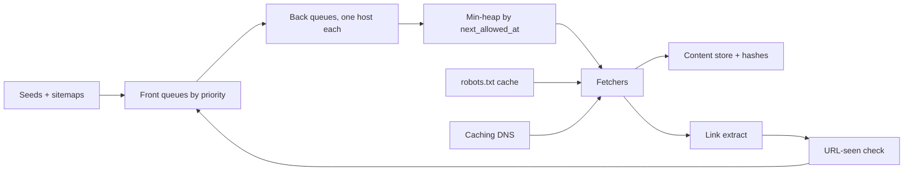
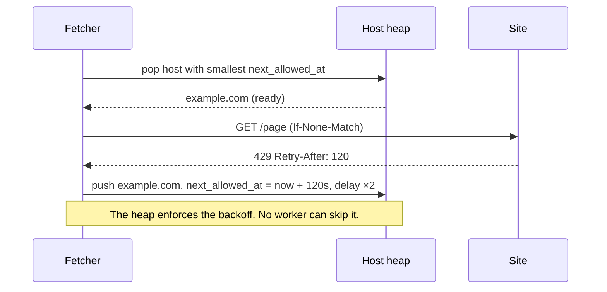

<!-- day-nav -->
[← Day 72 — Ephemeral stories](72-ephemeral-stories.md) · [Day 74 — Order book →](74-order-book.md)

# Day 73 — Web crawler

**Do now**

1. Set a timer.
2. Attempt the problem. Stop at the attempt line. Do not scroll.
3. Then read.

## Time box

40 minutes.

| Minutes | Do this |
|---|---|
| 0–12 | Attempt. Polite frontier, dedupe, freshness. Do not melt one host. |
| 12–32 | Read. robots.txt, per-host budgets, URL normalization. |
| 32–40 | Say frontier structure, politeness, and re-crawl policy. |

## Intent

Facing the public web as input, leave able to run a polite frontier with dedupe and freshness so one host is not melted.

## Problem

> Design a web crawler.
>
> You discover URLs, fetch pages, extract links, and keep content reasonably fresh. You must not overwhelm any single host.

## Attempt before reading

12 minutes. Do not scroll.

Write:

1. Frontier: prioritized URL queue.
2. Per-host rate limit / politeness delay.
3. Dedupe: URL canonicalization + content hash.
4. Freshness: revisit schedule.
5. Failure: soft 404, traps, infinite calendars.

---

**Stop. Host-aware frontier. Canonical dedupe. Budgeted politeness.**

---

## Requirements

**In.** Billions of URLs over time; continuous crawl. Honor robots.txt. Per-host QPS caps. Store raw pages plus extracted links. Recrawl by change rate and importance.

**Assumptions.** Fetch capacity **100k**/s global; per host default **1**/s unless the site asks for slower. Mean page **50 KB**. Large seed set plus sitemaps.

**Out.** Search ranking and indexing (a separate system), JS rendering farm deep dive (mention as an optional tier), malware detonation.

## Estimates

- **Bytes.** 100k/s × 50 KB = **5 GB/s** (40 Gbit/s). Per day: **~432 TB raw**, roughly 90–110 TB after HTML compression.
- **Fetches.** 100k/s × 86,400 = **8.64B fetches/day**.
- **The number that shapes the design.** At 1 req/s per host, you need **≥100k hosts with ready budget at every instant** to keep fetchers busy. Throughput is capped by how many hosts are ready, not by how many machines you own.
- **Big sites are slow on purpose.** A 10M-page site at 1/s takes 10M seconds, about **116 days**, for one full pass. You will never crawl it all; you pick which pages earn the budget.
- **URL-seen set.** 10B URLs × 8-byte fingerprint = **80 GB** before overhead. A Bloom filter at 1% false positives needs ~9.6 bits per URL, about **12 GB**.

## API and data

Internal flow: frontier leases URL → fetcher → content store → parser → URL-seen check → enqueue links.

- **URL key.** Canonical form, stored as a 64-bit fingerprint.
- **Host key.** Hostname, with a second budget per IP (shared hosting puts thousands of hosts on one server).
- **Per-host record.** `next_allowed_at`, current delay, error streak, robots.txt copy plus fetch time, `ETag` / `Last-Modified` per URL for conditional GETs.

## Design

### Frontier: front queues and back queues

Use the Mercator split.

- **Front queues** sort by priority (seed, sitemap, inlinks, change rate).
- **Back queues** hold one host each. A min-heap keyed by `next_allowed_at` tells a fetcher which host it may hit next.
- When a back queue empties, refill it from the front queues with a new host.
- Rule of thumb from Mercator: about **3× as many back queues as fetcher threads**, so a thread rarely waits on an empty heap.

The heap is the politeness mechanism. A fetcher can't take a URL from a host whose time hasn't come.

### Politeness without a distributed lock

Shard the frontier by host hash. One node owns each host's queue and budget, so "central host budget" costs no cross-node coordination per fetch.

- After each fetch, set `next_allowed_at = now + delay`.
- On **429 or 503**, honor `Retry-After` and double the delay. On repeated timeouts, back off the same way.
- Cap per IP too. Otherwise 5,000 small blogs on one shared server get hit at 5,000 req/s.

### robots.txt

RFC 9309 (2022) standardized the protocol. Know the parts that bite:

- **Cache it.** Don't hold a copy longer than 24 hours unless the file is unreachable.
- **4xx on robots.txt** (including 404) means no restrictions. You may crawl.
- **5xx or network error** means assume **full disallow** until it recovers.
- **`Crawl-delay` is not in the RFC.** Some crawlers honor it (Bing does); Google ignores it. Treat it as a hint you may respect, never as your only politeness control.

### DNS

At 100k fetches/s, DNS becomes a bottleneck fast. Run a local caching resolver, resolve asynchronously, and cache per host. Mercator called out DNS as a major cost in early crawlers.

### Dedupe: three layers

1. **Normalize URLs.** Lowercase scheme and host, drop default port and fragment, resolve `..`, strip tracking params from a per-host allow-list. Follow redirects before enqueue.
2. **URL-seen test.** Fingerprint lookup against a sharded store or Bloom filter. A Bloom false positive means you **skip a page you never fetched**. That's a coverage miss, not a double fetch. Pick the rate you can live with.
3. **Content dedupe.** Exact hash catches byte-identical copies. **SimHash** catches near-duplicates: Google reported 64-bit fingerprints with a Hamming distance of ≤3 on 8B pages (Manku et al., 2007).

### Traps

Calendars, session IDs in URLs, and endless faceted filters generate infinite URLs. Cap:

- path depth and URL length;
- query params per URL;
- **new URLs discovered per host per day** (the cap that catches traps you didn't predict).

When a host blows its cap, freeze discovery there and flag it for review.

### Freshness

Keep a priority queue on `next_fetch_at`. Adapt the interval per page: shorten it when the content hash changed, lengthen it when it didn't.

- Send **conditional GETs** (`If-None-Match`, `If-Modified-Since`). A `304` costs headers, not 50 KB.
- Don't chase pages that change every minute. Cho and Garcia-Molina showed that revisiting in proportion to change rate can lose to uniform revisits on average freshness. A page that changes faster than you can return is stale again by the time you're back.

### Staff arithmetic: politeness is capacity

Per-host limits, not your fleet size, decide throughput. 100k/s needs 100k ready hosts, and a 10M-page site needs 116 days at 1/s. So the frontier is a scheduling problem: which hosts are ready, which pages on them earn the budget, and when to come back. A global QPS alone lets one big site eat every fetcher and gets you banned.

## Diagrams

Caption: "Fetchers only take hosts whose time has come. New links pass the seen-check before they re-enter the frontier."

## Failure the user sees

Here the "user" is the search or data team downstream, and the site owners you crawl.

**Banned by a major host.** Too aggressive, or ignored a 429. Their pages vanish from the corpus. Shared crawler IP reputation makes it worse.

**Duplicate near-identical pages.** Storage and downstream pollution. Fix with canonical URLs plus SimHash.

**Frontier explosion.** A calendar or session-ID trap floods the queue. The per-host new-URL cap is the guardrail.

**Stale corpus.** Important hosts never get revisited because the frontier is busy with trap URLs or fast churners.

**robots.txt ignored.** Legal and reputation failure. Cache it, respect 5xx-means-disallow, refetch daily.

## Trade-offs

**BFS vs prioritized freshness.** Priority by importance and change rate in production. BFS only for teaching.

**Bloom filter vs exact URL-seen store.** Bloom is ~12 GB for 10B URLs but silently drops a sliver of new pages. An exact sharded store is ~80 GB+ and never lies. Choose by how much a missed page costs.

**Name the refusal inside each alternative.** Against global-only rate limits: you refuse host bans and unfairness. Against storing every URL variant: you refuse dedupe death. Against ignoring robots.txt: you refuse a policy violation. Against JS rendering by default: you refuse a second browser farm unless the target needs it. Against one queue for all hosts: you refuse head-of-line blocking by one slow host.

**10× URLs.** More frontier shards and URL-seen shards. Per-host caps stay the same, so throughput only grows if ready hosts grow.

## Talking points

**If they use one global QPS.** "Per-host budgets, or one big site eats every fetcher and bans us."

**If they ask how workers coordinate.** "Shard the frontier by host. One owner per host means no lock per fetch."

**If they ask dedupe.** "Canonical URL, fingerprint seen-check, then exact hash plus SimHash on content."

**If they ask robots.txt edge cases.** "Cache under 24 hours. 404 means crawl, 5xx means stop. Crawl-delay is non-standard."

**If they ask JS rendering.** "Optional expensive path for allow-listed hosts, not the default."

**If they ask what pages.** "Per-host 429 and error rate, frontier growth per host, robots fetch failures, and fetch-ready host count."

## Say this in the room

A crawler is a host-aware scheduler, not a global wget loop. At 1 req/s per host, 100k fetches/s needs 100k ready hosts, so I use Mercator-style front queues for priority and back queues per host, with a heap on next-allowed time. I shard by host so one node owns each host's budget. I dedupe with canonical URLs, a fingerprint seen-check, and SimHash. I obey robots.txt per RFC 9309 and back off on 429. Traps hit a per-host new-URL cap, and recrawl uses conditional GETs with adaptive intervals.

### Staff depth: the ready-host count is your throughput

Most candidates size fetchers. Staff candidates size **ready hosts**. Then they name the per-IP cap, the host-sharded frontier, and the 5xx robots rule.

**What staff sounds like.** "Politeness is capacity. I'd rather miss part of a giant site than get banned from it."

### More probes, with the answer

**"What pages?"** Per-host 429 rate (should be near 0), ready-host count vs fetcher count, frontier growth per host (trap signal), robots fetch failure rate. **"What do you refuse?"** A global QPS knob, unbounded discovery per host, JS rendering by default. **"What is the sensitive assumption?"** Mean page size and the per-host rate. At 500 KB pages you need 50 GB/s. At 0.1 req/s per host you need 1M ready hosts. **"Where does the time go?"** Lock the ready-host math before debating storage engines.

## Worked numbers you can reuse

| Quantity | Planning value | Why it matters |
|---|---|---|
| Global fetch rate | 100k/s | Fleet and bandwidth sizing |
| Mean page | 50 KB | Bytes per fetch |
| Ingest | 5 GB/s (~432 TB/day raw) | Network and storage |
| Fetches / day | 8.64B | Frontier churn |
| Per-host rate | 1 req/s default | Politeness floor |
| Ready hosts needed | ≥100k | Real throughput limit |
| 10M-page site, one pass | ~116 days | Prioritize, don't finish |
| URL-seen, exact | ~80 GB for 10B | Shard plan |
| URL-seen, Bloom 1% | ~12 GB for 10B | Memory vs coverage |
| robots.txt cache | ≤24 h | RFC 9309 |
| Back queues | ~3× fetcher threads | Mercator heuristic |

If the interviewer doubles page size, recompute bandwidth first. If they halve the per-host rate, recompute ready hosts before you touch anything else.

## Kit artifact

| Follow-up | You answer with |
|---|---|
| "Politeness?" | Per-host heap on next-allowed time, per-IP cap, 429 backoff. One owner per host. |
| "robots.txt is 503." | Assume full disallow until it recovers. |
| "Infinite calendar." | Per-host new-URL cap plus depth and param limits. |

## Design log

One line: how you stopped many workers from hitting one host in parallel.

Next: [Day 74 — Order book](74-order-book.md). Single sequence matcher; rebuild after crash.

---

<!-- day-nav -->
[← Day 72 — Ephemeral stories](72-ephemeral-stories.md) · [Day 74 — Order book →](74-order-book.md)
