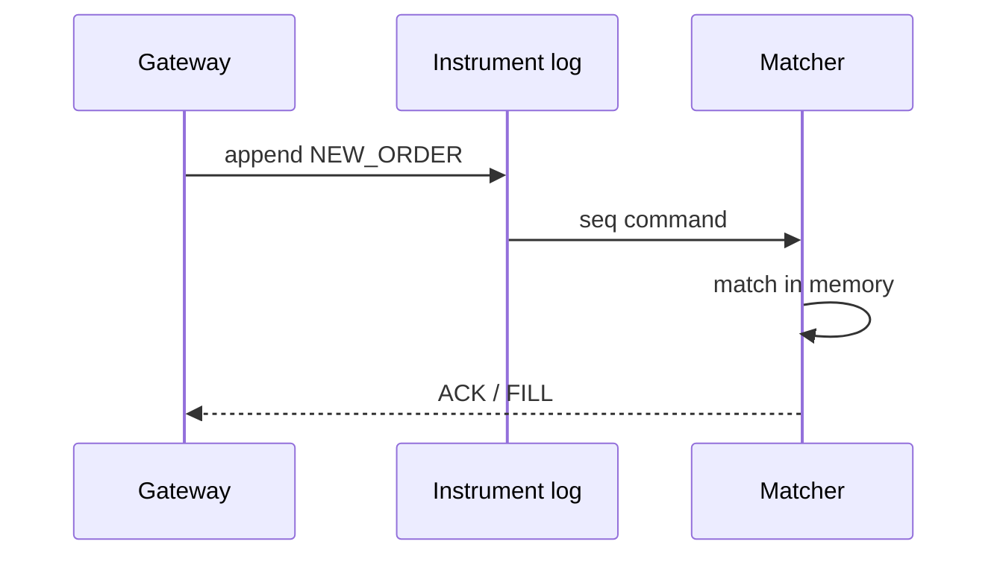
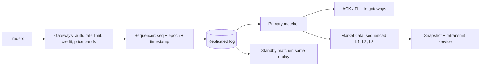
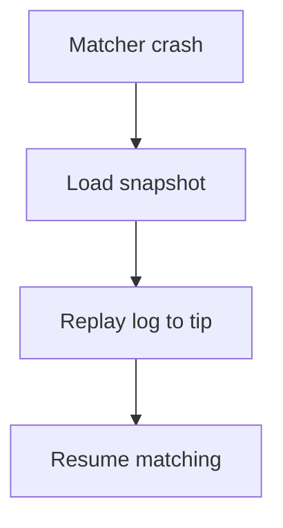

<!-- day-nav -->
[← Day 73 — Web crawler](73-web-crawler.md) · [Day 75 — Feature flags →](75-feature-flags.md)

# Day 74 — Order book

**Do now**

1. Set a timer.
2. Attempt the problem. Stop at the attempt line. Do not scroll.
3. Then read.

## Time box

40 minutes.

| Minutes | Do this |
|---|---|
| 0–12 | Attempt. Match one instrument on a single sequence. Rebuild after matcher crash. |
| 12–32 | Read. Multi-writer matching forks the book. Persistence is the log of orders/events. |
| 32–40 | Say the matching leader, the log, and recovery. |

## Intent

Facing buy and sell orders, leave able to match one instrument on a single sequence and rebuild the book after the matcher crashes.

## Problem

> Design an order book.
>
> Traders submit buy and sell orders for one instrument. The system matches them by price-time priority. If the matcher dies, you must restore the book correctly.

## Attempt before reading

12 minutes. Do not scroll.

Write:

1. Order types in scope (limit only is fine).
2. Why one sequencer / leader per instrument.
3. Persistence: event log vs snapshot+log.
4. Client ack: when is the order "in the book"?
5. Recovery time and what traders see during it.

---

**Stop. Single matcher sequence. Durable event log. Snapshot for fast rebuild.**

---

## Requirements

**In.** Limit orders, cancel, and an optional market order. Price-time priority. Partial fills. Every trade emits fills to both sides. One matcher per instrument. Deterministic replay after a crash.

**Assumptions.** **50k** order messages/s peak on a hot instrument, **1,000** instruments, each with its own matcher. Around **100k** resting orders on a busy book. Matching runs in µs inside one process; the client's network round trip dominates what traders feel.

**Out.** Multi-venue smart order routing, market data UI, surveillance ML, cross-instrument atomicity (spreads and baskets).

## Estimates

- **One core is enough.** LMAX reported about **6M orders/s** on a single business-logic thread (Fowler, *The LMAX Architecture*, 2011). Your 50k/s hot symbol is ~1% of that. Don't parallelize matching to buy throughput you already have.
- **Log volume.** At ~100 B per event, 50k/s is **5 MB/s** per hot symbol. A 6.5-hour session at sustained peak is **~1.17B events, ~117 GB**. That's an upper bound; real days are spikier and smaller.
- **Book in memory.** 100k resting orders × ~64 B ≈ **6.4 MB**. Snapshots are cheap, so take them often.
- **Rebuild time.** With a snapshot every 60 s at 50k/s, the worst case is **3M events** to replay. At a planning replay rate of 1M events/s (no client I/O during replay), that's **~3 s** plus snapshot load.
- **The number that shapes the design.** Durable-ack latency. A local group-committed fsync plus a same-datacenter replica round trip is usually well under a millisecond. That, not matching, sets your ack time.

## API and data

Inbound, through a gateway: `NEW_ORDER(firm, clOrdId, side, price, qty)`, `CANCEL(firm, clOrdId)`.

Outbound: `ACK`, `REJECT`, `FILL(price, qty, leaves)`, `CANCEL_ACK`, `CANCEL_REJECT`, plus a market data stream.

- **Idempotency key.** `(firm, clOrdId)`. FIX calls it ClOrdID (tag 11). A resend after a dropped connection must not create a second order.
- **Prices are integers.** Store ticks, never floats. Float rounding breaks both matching and deterministic replay.
- **Log entry.** `seq`, `epoch`, sequencer timestamp, command. Seq is the only truth for time priority.
- **Snapshot.** Full book state, last applied `seq`, and a hash of the book for replay checks.

## Design

### The book in memory

Each side is a sorted map of price levels (a tree, or an array indexed by tick when prices stay in a tight band). Each level is a FIFO list of orders. That FIFO is time priority.

- Keep a hash map `order_id → list node`, so cancel is **O(1)**, not a scan.
- Cache best bid and best ask. Most incoming orders touch only the top level.
- An incoming buy walks asks from the lowest price up, filling the oldest order first at each level, until it runs out of quantity or the price no longer crosses. Leftover quantity rests on the bid side.
- Some futures markets use pro-rata at a level instead of FIFO. Ask which rule the venue wants before you code the level.

### Sequencer and log

Gateways do the cheap checks first: auth, per-firm rate limits, credit limits, and fat-finger price bands. Then they forward to the instrument's sequencer.

The sequencer stamps `seq` and a timestamp, appends to the log, and replicates it. LMAX did journaling and replication on the input side, before the business logic ran. The matcher consumes commands strictly in `seq` order.

**When to ack.** Pick log-durable-then-apply. `ACK` then means "sequenced and durable," so a crash after the ack can't lose the order. `ACK` never means "filled." Fills are separate events.

### Determinism rules

Replay only works if the matcher is a pure function of the log.

- No wall-clock reads inside the matcher. Use the sequencer's timestamp from the log entry.
- No floats. No iteration over unordered hash maps when output order matters.
- No calls out to other services mid-match. Risk checks happen before sequencing, not during.

Break one of these and replay builds a different book from the same log.

### Hot standby and fencing

Run a standby matcher that consumes the same log and keeps an identical book. Failover then takes seconds, not a cold rebuild.

The danger is two live matchers. Each leader term gets an **epoch**; the log rejects appends and outputs from an older epoch ([Day 36](36-a-leader-is-a-dependency.md)). Two matchers emitting fills from one book is the worst bug this system can have.

### Recovery

Load the latest snapshot. Replay the log from its `seq` to the tip. Compare the book hash at checkpoints. Resume.

During the rebuild, the symbol is halted. Gateways reject new orders with a clear "symbol halted" reason instead of queueing them silently. Other symbols keep trading.

### Market data

Publish a sequenced event stream, not per-user copies.

- **L1** is top of book. **L2** is aggregated depth per price. **L3** is every order (Nasdaq TotalView-ITCH is order-by-order).
- Each message carries a feed `seq`. A client that sees a gap stops trusting its book, then asks for a retransmit or reloads a snapshot and replays forward.
- This is the same catch-up idea as chat ([Day 54](54-large-room-chat.md)): sequence numbers plus snapshot.

### Staff arithmetic: single matcher sequence

Total order per instrument is the whole design. One core already covers ~100× the hot symbol's load, so parallel matching buys risk, not speed. The real latency cost is the durable ack, which you control with group commit and a same-DC replica. Rebuild time is snapshot interval × message rate ÷ replay rate, so you tune the snapshot interval to meet the halt SLO.

## Diagrams

Caption: "One sequence. Memory book is a projection of the log."

Caption: "Checks before the sequencer, determinism after it. The standby replays the same log, so failover is a switch, not a rebuild."

Caption: "Rebuild is deterministic replay, not inventing state."

## Failure the user sees

**Double match.** Two takers fill the same resting liquidity. A money bug. Caused by parallel matchers or a missing epoch fence.

**Lost order after ACK.** The trader was told "accepted," then the order vanished on restart. Caused by acking before the log was durable.

**Duplicate order.** The client resent after a timeout and now has twice the position. Prevented by `(firm, clOrdId)` dedupe at the gateway and sequencer.

**Too late to cancel.** The cancel arrives after the fill. The trader gets `CANCEL_REJECT` with the fill already sent. That's correct behavior; say it before they ask.

**Symbol halted.** The matcher is down. New orders and cancels are rejected for that symbol until rebuild or failover. Other symbols trade on.

**Stale top of book.** A market data gap leaves a client showing the wrong best price. The client detects the gap by `seq` and resyncs.

**Self-trade.** A firm's buy hits its own resting sell. Common prevention modes: cancel newest, cancel oldest, cancel both, or decrement both by the overlap.

**Market order sweeps the book.** A big market order in thin liquidity fills at absurd prices. Price bands at the gateway cap it, and the unfilled rest is canceled.

## Trade-offs

**In-memory book + log vs a database row per level.** In memory for latency. The log is the truth you rebuild from.

**Hot standby vs cold rebuild.** A standby doubles the matcher fleet but cuts failover to seconds. A cold rebuild is cheaper and may still fit a halt SLO, given the ~3 s replay math above.

**Name the refusal inside each alternative.** Against multi-threaded matching on one symbol: you refuse double fills. Against Kafka as the matcher without a single consumer per symbol: you refuse races. Against rebuilding only from DB snapshots: you refuse lost fills. Against client clocks for priority: you refuse unfair ordering. Against floats for price: you refuse replay drift.

**10× messages.** 500k/s still fits one core per symbol. Scale by symbols per host, core pinning, and log throughput. Re-check the rebuild math: replay time grows 10× unless you snapshot more often.

## Talking points

**If they shard one symbol's matching.** "No. One core already handles about 100× this load. Shard by symbol."

**If they ask what ACK means.** "Sequenced and durable. Not filled. Fills come as separate events."

**If they ask persistence.** "Every command goes in the log before the matcher applies it. Snapshots bound replay time."

**If they ask fairness.** "Price-time priority by sequencer order. Per-firm rate limits at the gateway."

**If they ask failover.** "Hot standby replays the same log. Epoch fence so the old leader can't emit fills."

**If they ask market data.** "Sequenced L2 or L3 stream. Clients detect gaps by seq and resync from snapshot."

**If they ask what pages.** "Sequencer-to-ack latency, matcher lag behind log tip, standby lag, feed gap rate, and rebuild time against the halt SLO."

## Say this in the room

An order book is one matcher sequence per instrument. Gateways check auth, rate limits, credit, and price bands, then a sequencer stamps seq and epoch and writes a replicated log. I ack once the order is durable, and ack means accepted, not filled. The matcher is deterministic: integer ticks, sequencer timestamps, no outside calls. A hot standby replays the same log behind an epoch fence. Market data is a sequenced stream with snapshot recovery. Rebuild time is snapshot interval times message rate over replay rate, and I size it to the halt SLO.

### Staff depth: the log is the product

Most candidates design the matching algorithm. Staff candidates design the log: what `ACK` promises, how dedupe works, why replay is deterministic, and how the old leader is fenced. The matcher is a projection of that log.

**What staff sounds like.** "One core covers the load, so I spend my complexity on the ack, the fence, and the rebuild SLO."

### More probes, with the answer

**"What pages?"** Sequencer-to-ack p99, matcher lag, standby lag, feed gap rate, and time to rebuild. **"What do you refuse?"** Parallel matching on one symbol, floats for price, acking before durable. **"What is the sensitive assumption?"** Message rate times snapshot interval. At 10× rate with the same interval, rebuild is ~30 s, and that may break the halt SLO. **"Cancel races a fill?"** Whichever the sequencer ordered first wins. A late cancel gets `CANCEL_REJECT`. **"Why not timestamps from the client?"** Clocks drift and can be gamed. Sequence is priority.

## Worked numbers you can reuse

| Quantity | Planning value | Why it matters |
|---|---|---|
| Hot symbol rate | 50k msgs/s | Load per matcher |
| Single-thread matching | ~6M orders/s (LMAX, 2011) | Why one core is enough |
| Event size | ~100 B | Log sizing |
| Log rate, hot symbol | 5 MB/s | Disk and replica bandwidth |
| Session at sustained peak | ~1.17B events, ~117 GB | Upper bound per day |
| Resting orders | ~100k × 64 B ≈ 6.4 MB | Snapshot is cheap |
| Snapshot interval | 60 s | Bounds replay |
| Worst-case replay | 3M events ≈ 3 s at 1M/s | Halt SLO check |
| Durable ack | sub-ms in one datacenter | Sets trader-visible latency |

If the interviewer raises the message rate, recompute replay time first. If they move the replica to another region, recompute ack latency before you touch anything else.

## Kit artifact

| Follow-up | You answer with |
|---|---|
| "Matcher dies." | Standby takes over behind an epoch fence. No standby: snapshot + deterministic replay, symbol halted meanwhile. |
| "What does ACK mean?" | Sequenced and durable, not filled. |
| "Client resends." | Dedupe on `(firm, clOrdId)`. |
| "Feed gap." | Client detects by seq, requests retransmit or reloads snapshot. |

## Design log

One line: when you ack relative to durable log, and how recovery rebuilds.

Next: [Day 75 — Feature flags](75-feature-flags.md). Low-latency flags, stale bound.

---

<!-- day-nav -->
[← Day 73 — Web crawler](73-web-crawler.md) · [Day 75 — Feature flags →](75-feature-flags.md)
