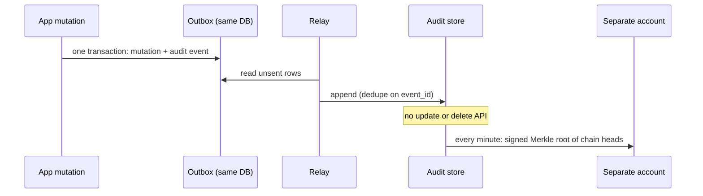

<!-- day-nav -->
[← Day 75 — Feature flags](75-feature-flags.md) · [Day 77 — Mock: email inbox →](77-mock-email-inbox.md)

# Day 76 — Audit log

**Do now**

1. Set a timer.
2. Attempt the problem. Stop at the attempt line. Do not scroll.
3. Then read.

## Time box

35 minutes.

| Minutes | Do this |
|---|---|
| 0–10 | Attempt. Who did that. Append queryable log, retention, tamper claim you can keep. |
| 10–28 | Read. If you claim "immutable" on mutable SQL without evidence, weaken the claim. |
| 28–35 | Say append path, query index, retention, and the honest tamper story. |

## Intent

Facing "who did that," leave able to append a queryable activity log with retention and a tamper claim you can actually keep.

## Problem

> Design an audit log.
>
> Security and support need to know who did what to which resource, when. The log must be queryable, retained for a policy window, and resistant to silent tampering by an ordinary attacker — with an honest claim.

## Attempt before reading

10 minutes. Do not scroll.

Write:

1. Event schema: actor, action, resource, time, evidence.
2. Write path: sync with mutation or async outbox?
3. Query: by actor, by resource, time range.
4. Retention and legal hold.
5. Tamper: what threat model, what mechanism (WORM, hash chain, external notarize)?

---

**Stop. Append-only store with real controls. Outbox from mutations. Honest tamper bound.**

---

## Requirements

**In.** Emit audit events for sensitive mutations. Query by actor/resource/time. Retention **1–7 years** per class. Admin access to audit is itself audited. Export for legal.

**Assumptions.** **5,000** audit writes/s peak. Query QPS low but selective indexes matter.

**Out.** Full SIEM product, packet capture, guaranteeing integrity against root on the cloud account without external notarization — **say the limit**.

## Estimates

5k/s × 500 bytes ≈ **216 GB/day**, about **79 TB/year** raw. Hot index for the recent **90 days**; compressed cold archive for the rest. Full math in Worked numbers below.

## API and data

Internal `Emit(event)`. `GET /v1/audit?actor=&resource=&from=&to=`.

Store: append-only table/log + object archive. Hash chain optional per stream.

## Design

### Event schema: write evidence, not a diary

Every event answers five questions. Get these fields right and the queries take care of themselves.

| Field | Example | Why it's there |
|---|---|---|
| `event_id` | UUID from the producer | Dedupe. The outbox relay delivers at least once. |
| `actor` | `user:841`, `svc:billing`, `admin:ops-3 via ticket SEC-112` | Who. Include *on behalf of* when a support agent acts as a user. |
| `action` | `role.grant`, `doc.delete`, `authz.deny` | What. A fixed list of verbs, not free text. |
| `resource` | `org:77/doc:9031` | To which thing. Hierarchical so you can query an org. |
| `event_time` + `ingest_time` | two timestamps | When it happened vs when you stored it. The gap is your lag metric and your clock-skew alarm. |
| `outcome` | `success` / `denied` / `error` | A denied attempt is often the most useful row. |
| `context` | IP, session id, request id, before/after hashes | Evidence. Store hashes or references for sensitive values, not raw PII. |

### Emit: the outbox carries the audit intent

Write the audit event into an outbox table **in the same database transaction** as the mutation (day 39). The delete and its audit row commit together or not at all. A relay reads the outbox and appends to the audit store.

Three consequences to say out loud:

- **At least once.** The relay can crash after sending and before marking the row done. The audit store dedupes on `event_id`, so a retry appends nothing new.
- **Audit store down doesn't block users.** The outbox just grows. At 5,000 events/s that's **18M rows an hour**. Page on outbox age, not row count.
- **Set a backlog cap.** Past the cap (say one hour of headroom), block the *most sensitive* mutations (role grants, key exports, payouts) rather than pile up unaudited risk. Ordinary edits keep flowing.

Without the outbox you dual-write: app writes the DB, then the audit store. A crash between the two gives you a deleted record with no evidence. That gap is the exact thing auditors find.

### Store and query: hot index, cold archive

- **Hot (90 days).** Two access patterns: `(actor, time)` and `(resource, time)`. A wide-column table or search index with both keys. Support queries land in seconds.
- **Cold (to 7 years).** Hourly batches as compressed columnar files in object storage, partitioned by date. Investigations on old data take minutes, and that's fine. Say it.
- **No update, no delete API.** Corrections are new events that point at the old `event_id`.

### Tamper evidence: match the mechanism to the attacker

Name the attacker first, then the control. One mechanism doesn't cover all three.

| Attacker | Control | What it stops | What it doesn't |
|---|---|---|---|
| App bug or compromised service | Append-only IAM; service role can write, never update or delete | Edits and deletes through the app | Anyone with storage admin |
| Rogue DB or storage admin | Hash chain per partition, with the chain head signed and published to a **separate account** every minute | Silent edit, insert, or tail truncation: the recomputed chain won't match the published head | Rewrites before the next publish (up to one minute) |
| Admin of the whole cloud account | Object storage with a **compliance-mode retention lock** (S3 Object Lock is one example) plus heads anchored outside your control | Deletion during the retention window, even by root | Data that never got written. Integrity starts at append. |

**How the hash chain works.** Each record stores `h_n = H(h_{n-1} || event_n)`. Change any old event and every later hash changes. One chain at 5,000 events/s needs one serialized writer, so split into, say, **64 partitions** (about 80 events/s each). Each minute, build a Merkle root over the 64 heads, sign it with a key the audit admins can't use, and publish it elsewhere. Certificate Transparency logs use the same Merkle idea, so it's a pattern you can cite.

**The honest claim.** "We detect any rewrite of appended events after the next checkpoint. We can't prove an event that was never emitted." That's a claim a staff engineer can defend.

### Retention, legal hold, and PII

- **Per-class retention.** Login events 1 year, financial and permission changes 7 years. Lifecycle rules expire whole partitions, never single rows.
- **Legal hold** overrides expiry for named resources or actors. Setting or clearing a hold is itself an audited, two-person action.
- **PII without breaking the chain.** Encrypt personal fields with a per-person key and hash the ciphertext into the chain. For an erasure request, delete the key. The data becomes unreadable while the chain stays valid. This is called crypto-shredding. Retention law beats erasure for some records, so legal sets the classes.

### Who audits the auditors

Reads of the audit log are audited too, into a store the audit admins can't write to. Exports for legal need a ticket and a second approver. Nobody owns both the system being audited and its audit trail.

### Worked numbers

| Item | Math | Result |
|---|---|---|
| Write volume | 5,000/s × 500 B | 2.5 MB/s ≈ **216 GB/day** raw |
| One year raw | 216 GB × 365 | ≈ **79 TB** |
| One year in archive | assume 5× columnar compression | ≈ **16 TB/year**, ≈ 110 TB over 7 years |
| Hot window | 216 GB × 90 days | ≈ **19 TB** of events |
| Hot indexes | 2 entries × ~100 B × 5,000/s × 90 days | ≈ **8 TB** |
| Outbox backlog | 5,000/s × 3,600 s | **18M rows/hour** if the relay stalls |
| Chain partitions | 5,000/s ÷ 64 | ≈ **80 appends/s** per serialized writer |

The sensitive assumption is **500 bytes per event**. Teams that dump full before/after JSON hit 5 KB, which makes everything above 10× bigger. Store hashes and diffs of sensitive fields, not whole documents.

## Diagrams

Caption: "Mutation and audit event commit together. The store only appends. A signed checkpoint outside the account makes rewrites detectable."

## Failure the user sees

**Missing audit rows after an incident.** Dual-write lost or outbox stalled — compliance failure. Page on outbox lag for audit topics.

**Tampered history.** Without WORM/hash chain, a privileged actor rewrites. Speak the detection bound.

**Audit write on request path.** Latency and outage couple to audit store — refuse sync mandatory on every click; outbox.

**PII in clear forever.** Retention + redaction policy; else you built a breach magnet.

**Query without indexes.** Investigations timeout — plan access patterns (actor, resource_id, time).

## Trade-offs

**Hash chain vs WORM bucket.** Either; name what attacks you stop.

**Sync vs async audit.** Async via outbox; accept seconds of lag; sync only for rare ultra-sensitive if product demands.

**Name the refusal inside each alternative.** Against dual-write without outbox: you refuse silent loss. Against mutable audit table UPDATEs: you refuse non-evidence. Against sync audit on every UX read: you refuse availability coupling. Against "we cannot detect tampering": you refuse claiming compliance without a bound. Against infinite PII retention without policy: you refuse a liability pile.

**10× mutations.** Outbox partitions; audit store append scale. Query indexes stay.

## Talking points

**If they UPDATE audit rows.** "Append only. Corrections are new rows."

**If they sync-write audit in the request.** "Outbox. Seconds of lag beat coupling outages."

**If they ask tamper proof.** "WORM or hash chain — detects rewrite after append. Not magical."

**If they ask what to log.** "Authz denials, mutations, admin actions — not every page view unless required."

**If they ask what pages.** "Audit outbox lag, write failures, query p99 for investigations."

## Say this in the room

An audit log is append-only evidence fed by outbox from mutating services so we do not dual-write ourselves into drift. Investigators query by actor, resource, and time on indexes we planned. Tamper evidence is a hash chain or WORM store with an honest bound — detects rewrite after append, not mythology. Audit must not sit synchronously on every user request path. PII retention and redaction are part of the design, not an appendix after a breach.

### Staff depth: append-only store with real controls

Outbox from mutations. Honest tamper bound. Async by default.

**What staff sounds like.** Refuse mutable audit; outbox lag paged; tamper bound spoken without theater.

### More probes, with the answer

**"Can a DBA quietly delete a row?"** "They can delete it, but not quietly. The next recomputed chain won't match the head we published to a separate account last minute."

**"What if the audit store is down for an hour?"** "The outbox holds about 18M rows. Users keep working. We page on outbox age, and past the cap we block only the most sensitive actions."

**"A user asks us to erase their data. Doesn't that break the hash chain?"** "Personal fields are encrypted per person. We delete the key, the chain still verifies, and the data is unreadable."

**"Why not one global chain?"** "One chain means one serialized writer. 64 partitions at about 80 appends a second each, tied together by a Merkle root every minute."

**"What's the sensitive assumption?"** "500 bytes per event. Full before/after documents push it to 5 KB and make storage 10× bigger."

## Kit artifact

| Follow-up | You answer with |
|---|---|
| "Immutable?" | Append-only IAM + outbox; WORM/notarize against admin; no fairy tales. |
| "Who's the attacker?" | App bug → append-only IAM. Rogue admin → hash chain + head published elsewhere. Account admin → compliance-mode retention lock. |
| "Audit store down?" | Outbox absorbs ~18M rows/hour; page on age; block only sensitive actions past the cap. |
| "Right to erasure?" | Per-person keys; delete the key (crypto-shredding); chain still verifies. |

## Design log

One line: your tamper threat model and the mechanism that matches it.

Next: [Day 77 — Mock: email inbox](77-mock-email-inbox.md). Closed book — not this week's graph/stories/crawler/book/flags/audit.

---

<!-- day-nav -->
[← Day 75 — Feature flags](75-feature-flags.md) · [Day 77 — Mock: email inbox →](77-mock-email-inbox.md)
